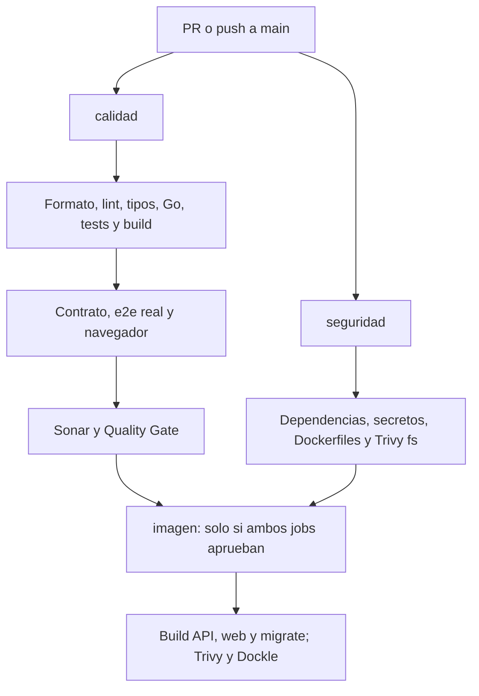
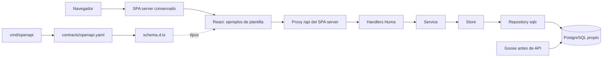

# Continuidad PINGESO Grupo 5 — integración local para Claude

Última actualización: 19 de noviembre de 2026, America/Santiago.
Documento vivo: actualizar al terminar cada bloque de trabajo, sin borrar la evidencia histórica ni sustituir resultados nuevos por resúmenes antiguos.

## 1. Lectura inicial y estado ejecutivo

El objetivo es terminar una integración LOCAL revisable del pipeline de Daniel con la plantilla de Benja, conservando controles y dejando preparado el contrato futuro de Manuel. NO desarrollar la parte de Manuel ni inventar dominio. NO cerrar Hito 0 mientras seguridad e imagen no estén aprobados.

**Ya existe la rama integration/pipeline-plantilla-local y su worktree. El merge está iniciado y sin commit. NO reconstruirlo, NO volver a ejecutar preparar-integracion-local.ps1, NO aplicar el parche encima.**

Estado comprobado por lectura de archivos el 19/11: HEAD simbólico apunta a esa rama, la referencia sigue en c445c03450692a0c7dd302b07edbbdf72ab20395; ORIG_HEAD tiene ese mismo SHA y MERGE_HEAD contiene 7d2b7dcc216eec847b78b7d7aeb4731aec1cd94d. Esto confirma un merge abierto, no una integración terminada. El índice y los cambios sin stage necesitan un git status actualizado; no se ejecutó ese comando desde Codex en esta entrega documental.

Últimos resultados aportados por Daniel: pnpm typecheck aprobado y pnpm test con **20/20 pruebas en 6 archivos aprobadas**. Cobertura frontend: sentencias 85,89%, ramas 71,95%, funciones 73,91%, líneas 84,93%. **No es cobertura nueva de Sonar ni cobertura Go ni aprobación del Quality Gate.**

La instalación frozen-lockfile, generación de contrato, formato/lint, comprobaciones Go y compilación ya tuvieron ejecuciones satisfactorias sobre estados anteriores de ESTA integración. No se ha ejecutado de principio a fin un pnpm verify satisfactorio sobre el estado final actual. Faltan auth/config/middleware, e2e real, Compose integrado, escaneos, revisión del merge y validación final.

## 2. Proyecto, autoría y límites de dominio

- Proyecto PINGESO, semestre 2 de 2026, Grupo 5. No confundir con VulnApp/DevSecOps, TAVI ni MateQuest.
- Daniel: pipeline, calidad/seguridad y preparación de integración.
- Benja (commits bajo locomotive1584): plantilla, tecnologías y ejemplos backend/frontend. Conservar su autoría e historia; Daniel/Codex adaptaron e integraron, no escribieron originalmente todo ese código.
- Manuel: contrato API funcional. No hay entrega identificable en la última revisión remota histórica; eso NO demuestra ausencia de trabajo local.
- Todos: pruebas de endpoints.

Según el resumen facilitado por Daniel/ChatGPT, Ideas (2).pdf enumera inventario, compra-venta, notificaciones, reportes de ingresos, registro de ventas, código de barras/impresora de tickets y dashboard. El PDF no se volvió a inspeccionar para esta entrega. Son ideas, NO siete microservicios acordados ni endpoints implementados. Confirmar documento de componentes, propietarios de datos y servicio asignado antes de desarrollar dominio. Grupo 5 NO implica servicio N=5 ni puertos 5150/5151.

Cada microservicio tiene repositorio, BD, contrato y pipeline propios. Primero se construye base reutilizable; después se adapta y compone para productos cliente.

## 3. Repositorio, rutas y fuentes

Repositorio: https://github.com/danieldiaz77-LAB/pingeso-grupo5
PR #1: https://github.com/danieldiaz77-LAB/pingeso-grupo5/pull/1
Ejecución histórica: https://github.com/danieldiaz77-LAB/pingeso-grupo5/actions/runs/42804942832

Raíz original:

```text
C:\Users\danie\OneDrive\Desktop\ULTIMOS SEMESTRES\Semestre 2_2026\Proyecto Ingeniería de Software (Pingeso)\Proyecto_PINGESO\pingeso-grupo5
```

Worktree ACTIVO, relativo a esa raíz:

```text
.tmp/worktree-integracion-pipeline-plantilla
```

Documento canónico actual: docs/integracion/continuidad-claude.md DENTRO del worktree. La raíz original tiene CONTINUIDAD_CLAUDE.md como acceso y PROMPT_PARA_CLAUDE.md como prompt. GitHub NO contiene los cambios locales de esta integración: Claude necesita acceso al disco o recibir los archivos. No podrá reconstruir todo viendo solo GitHub.

Fuentes que leer:

- docs/referencias/DAS — Desarrollo de Microservicios.md: copia del DAS leída. Si Daniel entrega otro DAS, comparar y registrar diferencias antes de decidir cuál rige.
- AGENTS.md aplicables: en búsquedas previas no apareció uno, pero volver a comprobar al retomar.
- docs/actualizaciones-pendientes.md, docs/modos-de-falla.md, docs/sonar-das.md.
- docs/integracion/contrato-manuel.md: flujo de contrato; contiene un bloqueo histórico de generación que ya fue superado.
- docs/integracion/validacion.md: runbook e2e/Compose aislado; su tabla del 17/11 es histórica.
- docs/integracion/estado.md y continuacion.md: preparación previa, no estado vigente; se les añadió aviso de supersesión.
- docs/integracion/dependencias.json, seguridad.md, resolucion-msw.md y revision-lock.json: diferencias de grafos y decisiones de resolución. revision-lock.json es una revisión intermedia, no certificación del último lock.

El adjunto de ChatGPT recibido el 19/11 decía todavía que no existía worktree, generados ni pruebas. Esas afirmaciones quedaron SUPERADAS por ejecución manual posterior y lectura de disco. Se incorporó su contexto y restricciones, pero no se retrocedió el estado.

## 4. Restricciones vigentes

1. No publicar la rama local, no push, no merge en main, no auto-merge; mantener PR #1 en borrador. No hacer commit automáticamente para que una comprobación quede verde. La integración abierta requiere revisión por archivo.
2. Conservar ramas originales, historial y cambios sin commit. No reset --hard, git clean, borrar el worktree ni resolver todo con git add --all.
3. No modificar protecciones, Quality Gate, umbrales ni excepciones. Cobertura NUEVA mínima 80%, aunque el DAS copiado menciona 60%.
4. No aplicar actualizaciones pendientes sin aprobación; el DAS exige PR separado y actualización de su referencia. No actualizar Node, pnpm, Go, Vite/Vitest o imágenes por sugerencias de consola.
5. No bases ajenas ni recursos Docker compartidos. PostgreSQL efímero propio, proyecto Compose único; no docker prune. Las pruebas originales de Benja podían truncar ejemplos: no usar esas versiones contra una BD real del usuario.
6. No tokens, contraseñas, cookies o secretos en documentación/salidas. Nunca pedir SONAR_TOKEN por chat. GitHub CLI existe en .tools/gh/bin/gh.exe; el resumen reporta login/setup-git previo, no se revalidó autenticación hoy.
7. No desactivar engine-strict, hooks, lint, formato, seguridad ni hacer exclusiones para inflar cobertura.
8. No eludir políticas Windows ni usar ExecutionPolicy Bypass. La ejecución manual del usuario está disponible; el bloqueo del agente no es global.

## 5. Estado Git y evidencia remota

SHA usados en la integración:

| Rama                                 | SHA conocido                                       |
| ------------------------------------ | -------------------------------------------------- |
| main                                 | ed6f74d33d696eb4cafe807291f3f891451928b1           |
| feat/pipeline-hito0                  | c445c03450692a0c7dd302b07edbbdf72ab20395           |
| feat/plantilla-hito0                 | 7d2b7dcc216eec847b78b7d7aeb4731aec1cd94d           |
| integration/pipeline-plantilla-local | HEAD aún en c445c034..., MERGE_HEAD en 7d2b7dcc... |

Los remotos fueron revisados en la etapa previa del 17/11 según el historial disponible; no se hizo consulta remota nueva el 19/11 y no se conserva aquí una hora exacta verificable. PR #1 estaba abierto/draft; no había PR de Benja ni contrato de Manuel publicado identificable. No presentar esos datos históricos como consulta actual.

Ejecución 42804942832 de la rama anterior: calidad aprobado (incluido gate), seguridad fallido, imagen omitido; Gitleaks/Hadolint aprobados. El resumen/evidencias registran 19 avisos alcanzables Go (17 stdlib, 2 x/text), audit 8 avisos y Trivy filesystem 2 HIGH. Son resultados históricos, NO escaneos de esta integración.

Protección histórica: listado de ramas devolvió main protected=false, rulesets []; consulta detallada administrativa dio 403. No certificar main protegida. Consultar en lectura si hay permisos y comunicar al administrador; no cambiarla.

### Conflictos y staging ya realizados por Daniel

El merge detectó 13 conflictos add/add: .editorconfig, apps/api/cmd/api/main.go, apps/api/go.mod, apps/api/go.sum, apps/api/internal/api/salud.go, apps/web/index.html, apps/web/package.json, apps/web/src/main.tsx, apps/web/tsconfig.json, apps/web/vite.config.ts, package.json, pnpm-lock.yaml y pnpm-workspace.yaml.

Tras revisión de contenido, Daniel ejecutó git add explícito para ocho: .editorconfig, index.html, package web, main.tsx, tsconfig, vite.config, package raíz y workspace. También git rm --cached --force -- apps/web/src/App.tsx; Test-Path confirmó que apps/web/src/app.tsx sigue existiendo. No repetir esa eliminación sin revisar índice.

Posteriormente se regeneraron/formatearon archivos y se modificó workspace; por eso stage y disco pueden diferir. Último estado completo del índice no consultado: verificar antes de actuar. Probables conflictos aún pendientes: main.go, salud.go, go.mod, go.sum y lock; no dar esa lista como estado actual sin git diff --diff-filter=U.

## 6. Preparación preservada y materialización

En la raíz original se conservan:

- .tmp/integracion-pipeline-plantilla-2026-11-17/: snapshot preparado, 141 archivos; no significa 141 archivos modificados.
- .tmp/integracion-pipeline-plantilla-2026-11-17-fuentes/: fuentes de Benja; 59 archivos originalmente comprobados contra blobs Git.
- .tmp/integracion-pipeline-plantilla-2026-11-17.manifest.json y .patch: manifiesto/hashes y parche del snapshot anterior, NO del worktree que siguió evolucionando.
- .tmp/preparar-integracion-local.ps1: script YA ejecutado. Verifica hashes/SHA, fetch, crea rama/worktree, merge --no-commit --no-ff y aplica preparación; conserva conflictos en índice, no hace commit/push.
- .tmp/revision-seguridad-integracion-bdfdbd5d/: respaldo de preparación anterior.
- .tmp/revision-onedrive-2026-11-17/: respaldo previo a corregir reparse points.
- .tmp/inquirer-retencion-* y .tmp/revision-lock-*: respaldos antes de overrides.

Primer bloqueo del script: rechazaba cualquier ReparsePoint de OneDrive. Daniel consultó fsutil: .tmp tenía etiqueta 0x9000a01a (CLOUD_A), sin LinkType/Target. Se corrigió para consultar y permitir solo familia CLOUD; rechaza symlink/junction/desconocidos, sin modificar los reparse points. Revalida rutas tras merge antes de aplicar archivos. Se actualizó hash del script en el manifiesto.

El script luego materializó el worktree y dejó los conflictos. El visor de git diff mostró (END): Daniel salió con q. No confundir ese paginador con un bloqueo o con el final de todas las operaciones.

## 7. Qué se integró y qué no

### Pipeline de Daniel conservado

.github/workflows/ci.yml conserva jobs exactos calidad, seguridad e imagen. Eventos pull_request y push a main; un push a rama sin PR no tiene disparador propio. Ubuntu 24.04, contents:read, límites de tiempo, cancelación de ejecución anterior del mismo PR, Actions por SHA e imágenes por digest.

| Archivo                               | Función                                                                               |
| ------------------------------------- | ------------------------------------------------------------------------------------- |
| package.json                          | verify con formato, lint, arquitectura, tipos, Go, tests y build; scripts dev/codegen |
| scripts/tareas.mjs                    | gofmt/go mod verify/vet/tests/build; sqlc; Huma; e2e instrumentado                    |
| scripts/contrato.mjs                  | seguimiento y vigencia de generados; oasdiff con base explícita                       |
| scripts/arquitectura.mjs              | reglas de imports/fetch/storage frontend                                              |
| scripts/mutacion.mjs                  | sensibilidad de readiness                                                             |
| scripts/validar-cobertura.mjs         | valida reporte Go; no equivale al gate remoto                                         |
| scripts/sonar.mjs                     | preflight de configuración/reportes                                                   |
| sonar-project.properties              | clasificación de fuentes/tests y reportes Go/lcov                                     |
| lefthook.yml                          | hooks; verificar instalación real por worktree                                        |
| Dockerfiles API/web/migrate y Compose | build, runtime, migraciones y orquestación                                            |

Calidad: frozen install, verify, mutación, generación/vigencia, compatibilidad con base, e2e real, navegador, Sonar y gate, artifacts. Seguridad: Gitleaks, mod verify/govulncheck, audit high, Hadolint error, Trivy fs HIGH/CRITICAL con fix. Continuar pasos para diagnóstico no vuelve exitoso un job fallido. Imagen depende de calidad y seguridad y construye/escanea API, web y migrate con Trivy/Dockle.

**No están implementadas en el workflow revisado publicación GHCR, despliegue, firma Cosign ni SBOM**, aunque son requisitos/objetivos del DAS. CI valida/construye, no atiende peticiones del usuario.



### Ejemplos de Benja incorporados

Backend GET/POST /api/v1/ejemplos; capas api/service/store/repository; migración 202611080001_crear_ejemplos.sql, queries, seed, sqlc.yaml y tests de service. Se conserva 00001_base_tecnica.sql. main del pipeline conecta el servicio de ejemplos; api.Nueva comparte registro con cmd/openapi. Se conservan healthz/readyz, límites HTTP, señales y logging del pipeline.

Frontend app.tsx en minúscula; microcomponente de ejemplos con formulario/listado/hooks, QueryClientProvider, cliente openapi-fetch en ejemplos.api.ts con URL por props y credentials include, MSW solo dev. Si MSW no arranca no hay fallback silencioso a API real. Pruebas movidas a apps/web/tests, Playwright de ejemplos preparado; preserve pruebas iniciales.

**Auth/config/middleware NO están incorporados todavía**: lectura de disco del 19/11 confirmó ausentes apps/api/internal/api/auth.go, middleware.go y internal/config/config.go. Sus originales y pruebas están en -fuentes. No tratarlos como funcionalidad aprobada ni su eliminación como resolución final.

Pendiente de ese bloque: integrar configuración con validaciones actuales, keyfunc/JWT, recuperación/logging sin duplicaciones, errores seguros, salud pública, fallo de arranque ante configuración inválida, ciclo de vida JWKS y pruebas. El wrapper original de Benja envolvía todo, incluida salud: no copiarlo ciegamente. No inventar permisos de Manuel; probar comportamiento técnico acordado y dejar requisitos de identidad explícitos.



El diagrama muestra la composición prevista en contenedores; todavía NO acredita Compose integrado probado.

### SPA y evidencia anterior

Se conserva la corrección del servidor SPA basada en os.Root y catálogo inmutable, con rechazo de bundles inválidos y pruebas de symlinks/fallback/assets/proxy/HEAD/cabeceras. La base anterior documentó 9 e2e, Go 171/180=95%, Sonar new coverage 95,1% y S6549 resuelto; Compose base probado, Mailpit no. Puertos 51781/51782 eran provisionales. **No atribuir cifras ni gate anteriores a esta integración.** Revalidar regresiones al ejecutar e2e integrado, sin eliminar controles previos.

## 8. Contrato único y corrección de nulabilidad

Fuente de verdad: structs Go y operaciones Huma en apps/api/internal/api/.
Composición: api.Nueva, usada por servidor y apps/api/cmd/openapi/main.go.
Generador único cmd/openapi → contracts/openapi.yaml → apps/web/src/api/schema.d.ts (openapi-typescript). Se descartó cmd/contrato y esquemas manuales esquema.ts/contrato.ts. sqlc genera repository desde migraciones/queries; no editar generados manualmente.

pnpm codegen ya se ejecutó con éxito y los generados contienen ejemplos, healthz y readyz. Las descargas de sqlc@v1.29.0 pertenecían a su grafo de herramientas; lectura posterior confirmó go.mod y go.sum de API intactos respecto del pipeline en ese punto.

Primer typecheck falló porque Huma declaraba ejemplos como arreglo o null y el frontend indexaba el arreglo. El handler ya hacía make([]Ejemplo, 0, ...); se añadió nullable:"false" al campo de ListarEjemplosSalida en Go, se regeneró y typecheck pasó. No se usó any, aserción ciega ni edición manual de schema.d.ts.

check:generated exige archivos seguidos por Git, no vacíos, ruta de ejemplos y ausencia de diff contra HEAD en contracts/src/api/repository, incluidos nuevos. En este merge sin commit hay diferencias legítimas contra HEAD: **no desactivar el check ni hacer commit prematuro para ocultarlas**. Antes de cerrar medir reproducibilidad con hashes antes/después de codegen y después, cuando proceda registrar un commit local revisado, comprobar contra su HEAD. Revisar la guarda específica de ejemplos cuando el contrato futuro cambie, sin debilitar vigencia.

## 9. Dependencias y entorno de ejecución

Windows/PowerShell 5.1; Git manual 2.53.0.windows.1. Node global era 24.21.0 y no había pnpm/Go en PATH. No se cambiaron instalaciones globales: existen herramientas portátiles en .tools de la raíz ORIGINAL.

Desde el worktree:

```powershell
. ..\..\scripts\entorno-local.ps1
node --version
pnpm --version
go version
```

Esperado Node 22.22.0, pnpm 10.13.1, Go 1.26.5. El script modifica PATH/GOPATH/GOCACHE de esa sesión; cargarlo de nuevo al abrir PowerShell. No usar el script homónimo del worktree apuntando a .tools inexistente allí.

### Resolución de dependencias frontend

Se añadieron paquetes del catálogo ya fijado: Base UI 1.6.0, React Query 5.101.4, react-hook-form 7.83.0, MSW 2.15.0, Tailwind y plugin 4.3.3. No se adoptaron bumps de @types/react/@types/react-dom de Benja.

La primera resolución trajo @inquirer/confirm 6.4.0 que exige Node ^22.22.2 || ^24.15.0 || >=26; falló con engine-strict. Se conservaron mediante overrides las versiones ya fijadas por Benja. Otra revisión detectó nueve transitivas más nuevas y se retuvieron también las de Benja. Son decisiones explícitas locales, no aprobación general de seguridad. El lockfile lo generó pnpm, no se escribió a mano.

Overrides actuales (comprobar archivo si cambia):

| Paquete                           | Versión retenida |
| --------------------------------- | ---------------- |
| @inquirer/ansi, @inquirer/figures | 2.0.10           |
| @inquirer/confirm                 | 6.3.5            |
| @inquirer/core                    | 12.0.6           |
| @inquirer/type                    | 4.2.1            |
| @babel/runtime                    | 7.29.13          |
| @types/node                       | 22.20.5          |
| enhanced-resolve                  | 5.26.1           |
| graceful-fs                       | 4.2.11           |
| set-cookie-parser                 | 3.2.2            |
| tapable                           | 2.3.3            |
| tldts-core                        | 7.4.20           |
| tldts                             | 7.4.19           |
| undici-types                      | 6.21.0           |

Última resolución mostró warning deprecated tldts-core@7.4.20 y peer openapi-typescript@7.13.0 requiere TS ^5.x, pero DAS fija TS 6.0.3. Generación y tipos han pasado; NO significa compatibilidad oficialmente soportada o ausencia de riesgo. Mantener avisos, revisar seguridad y aprobación sin upgrades silenciosos.

Grafo Go de Benja pendiente: keyfunc v3.9.1 y jwt v5.3.1 están en DAS, pero revisar transitivas separadas de Testcontainers/Goose. El go.mod completo de Benja cambia puddle 2.2.2→2.2.3, x/sync 0.20→0.24, x/text 0.37→0.43 y añade otras. No asumir que todos esos cambios son necesarios para auth; resolver grafo mínimo y detectar decisiones bloqueadas. Goose instalado con @v3.24.1 usa módulo propio: escanearlo por separado del binario API.

Propuestas históricas (NO aprobadas): Go 1.26.10, x/text 0.41.0, Vite 8.1.6, Vitest/mocker/coverage 4.1.12 y correcciones de Goose. No aplicarlas automáticamente ni degradar un grafo más nuevo para hacer coincidir una propuesta vieja.

### Ruta larga de Vitest: solucionada localmente

Vitest no arrancaba: ERR_PACKAGE_IMPORT_NOT_DEFINED para #module-evaluator. El paquete declaraba esa importación y el archivo existía. Prueba aislada con Node 22.22.0: manifiesto de 75 caracteres resolvía; el mismo manifiesto en ruta de 341 fallaba. El de Vitest tenía 297. Script diagnóstico en .tmp/diagnosticar-imports.cjs del worktree; creó carpeta temporal propia, no cambió políticas.

Daniel reinstaló con frozen-lockfile e ignore-scripts usando virtual-store-dir corto y único:
C:\Users\danie\AppData\Local\pnpm-pingeso-4086dfaa

La instalación reutilizó 189 paquetes, sin descargar ni resolver versiones nuevas; Vitest arrancó. Conservar esa carpeta; es usada por los enlaces de node_modules. No recrearla aleatoriamente en cada sesión. Para reinstalar, comprobar primero node_modules/.modules.yaml y reutilizar virtualStoreDir real. No fijar ruta personal en configuración versionada. No usar pnpm install sin ese parámetro si provoca cambio de ubicación a la ruta larga. No borrar almacenes ajenos.

### Bloqueo del agente distinto de problemas del proyecto

Codex obtuvo CreateProcessAsUserW failed: 1260 al crear powershell.exe desde su herramienta. Último intento mínimo documentado: git --version; no llegó a ejecutar Git. Mensaje: La directiva de grupo bloquea a este programa. Ejecutable C:\WINDOWS\System32\WindowsPowerShell\v1.0\powershell.exe.

Daniel sí ejecutó PowerShell, Git fetch (exit 0), Go, pnpm y Docker. No afirmar PowerShell bloqueado globalmente, credenciales ausentes o terminal reparada del agente. Codex continuó leyendo/editando archivos mediante herramientas de archivos, sin lanzar procesos alternativos para evadir la restricción. Si Claude encuentra el mismo bloqueo, una comprobación mínima y luego etapas manuales cortas con evidencia; no reintentos equivalentes indefinidos. El administrador debe identificar la regla del contexto del agente, no desactivar políticas globales.

Para código JS manual con PowerShell 5.1 evitar node -e con comillas complejas: una instrucción previa perdió comillas. Usar archivo .cjs o here-string literal canalizado a node. No copiar mensajes de error como comandos.

## 10. Pruebas: cambios y resultados reales

- Inicio React: al importar main dentro del test se cargaba todo el nuevo grafo y agotaba 5 s. Se importó App estáticamente en inicio.test.tsx y se reforzó que render recibe ese componente; no se aumentó timeout ni se quitó el caso sin root. Luego ambos pasaron.
- Nuevos ejemplos-api.test.ts: cliente real openapi-fetch con transporte MSW; crear/listar encadenados, credenciales/base URL, rechazo sin insertar, errores detail/title/fallback y 204 sin cuerpo.
- Primer intento de esas pruebas falló 6/7 con ECONNREFUSED: error de Codex al instanciar cliente antes de servidor.listen; capturaba fetch real. Se movió creación al beforeAll DESPUÉS de activar MSW. Última corrida 7/7 aprobadas. No fue necesario levantar API localhost ni cambiar producto.
- lista-ejemplos.test.tsx: lista vacía y presentación de dos registros/fecha/descripción alternativa, 2/2 aprobadas.
- Se mantienen tests originales y MSW de Benja adaptados. Estas pruebas no sustituyen e2e PostgreSQL ni navegador real.

| Validación                                          | Resultado acreditado                          | Límite                                                                    |
| --------------------------------------------------- | --------------------------------------------- | ------------------------------------------------------------------------- |
| Materializar worktree y merge                       | Ejecutado por Daniel                          | Merge abierto, conflictos/stage por revisar                               |
| pnpm install --lockfile-only --ignore-scripts       | Aprobado tras overrides                       | Avisos peer/deprecated conservados                                        |
| pnpm install --frozen-lockfile --ignore-scripts     | Aprobado                                      | También reinstalación con almacén corto; no upgrade                       |
| pnpm codegen                                        | Aprobado, también tras nullable:false         | Doble generación idéntica por hashes pendiente                            |
| gofmt y Prettier                                    | Ejecutados; check aprobado en verify anterior | Documentos/pruebas posteriores requieren check final                      |
| lint y arquitectura                                 | Aprobado en verify anterior                   | Repetir una vez tras cambios finales                                      |
| typecheck                                           | Aprobado en última salida del usuario         | Estado local sin commit                                                   |
| go mod verify, go vet, go test ./...                | Aprobados en verify anterior                  | NO acredita -tags=e2e con binario/BD                                      |
| pnpm test                                           | Última corrida 20/20, 6/6 archivos            | MSW/SSR, no BD real                                                       |
| pnpm build                                          | Aprobado antes de últimas pruebas añadidas    | Incluyó Vite y build-api (API y SPA); últimas modificaciones fueron tests |
| pnpm verify completo final                          | Pendiente                                     | Hubo intentos truncados en tipos/Vitest; piezas luego pasaron separadas   |
| Docker version / compose version                    | Aprobado                                      | Solo disponibilidad, NO Compose levantado                                 |
| E2E instrumentado PostgreSQL y aislamiento          | No ejecutado en integración                   | Código preparado                                                          |
| Playwright/navegador y mutación integrada           | No ejecutado                                  | Preparados/conservados                                                    |
| Compose integrado / migraciones / ready / proxy     | No ejecutado                                  | No usar evidencias previas como sustituto                                 |
| Govulncheck, audit, Trivy, Hadolint/Dockle actuales | No ejecutado en integración                   | Riesgos históricos pendientes                                             |
| Sonar y 80% cobertura NUEVA                         | No ejecutado/acreditado en integración        | 84,93% líneas frontend no equivale al gate                                |

Última salida enviada el 19/11: pnpm test inició a 22:56:05 según consola, duración 5,44 s; el log no incluye fecha propia, no inferir día exacto de ejecución solo del reloj. Resultados atribuidos a ejecución manual de Daniel, NO ejecución del agente.

Cobertura última por partes: ejemplos.api.ts y lista-ejemplos.tsx 100%; app.tsx 100%; main.tsx líneas 66,66%; formulario 50%; hook 50%; Ejemplos.tsx 75%; mocks/browser.ts 0%. Ramas globales 71,95% y funciones 73,91%. No excluir estos archivos para pasar. Completar pruebas útiles según fallos de comportamiento y gate efectivo.

## 11. PostgreSQL, e2e y Compose pendientes

Docker disponible: cliente/engine 29.2.1, Docker Desktop 4.62.0, contexto desktop-linux, servidor linux/amd64; Compose 5.0.2. Confirmado por salida manual. No se levantaron nuevos recursos de integración en estas etapas.

Tests HTTP adaptados en apps/api/e2e/ejemplos_handler_test.go, tag e2e: requieren TEST_DATABASE_URL y TEST_DATABASE_NAME prefijado pingeso_integracion_. Cada fixture crea schema aleatorio; URL y pool fijan search_path/timezone; Goose recibe misma URL y guarda goose_db_version allí; seed/handlers usan ese pool. Cleanup cierra servidor/pool y borra solo schema propio con identificador escapado; admin se usa para gestionar schema. TestAislamientoDeEsquemas exige independencia. Revisar nuevamente antes de ejecutar: prefijo de nombre NO prueba propiedad de una BD, el contenedor efímero propio la establece.

ejemplos_proceso_test.go conserva binario real instrumentado y prueba crear/listar/persistencia/rechazos, con golden. Runner scripts/tareas.mjs instala Goose v3.24.1 en ruta propia, prepara migraciones del proceso en public de BD EXCLUSIVA, compila API/SPA/OpenAPI con cobertura, exige escenarios y rechaza eventos skip/ausencia de contadores. No confundir httptest con binario real.

El runner e2e rechaza Windows nativo por señales/volcado de cobertura. Preparar Linux en contenedor de prueba o WSL autorizado, sin eludir política del agente. No quitar esa guarda para obtener verde. Leer docker-compose.integracion.yaml y runbook validacion.md; mantener proyecto/BD/credenciales/puertos propios. No ejecutar runbook Bash como PowerShell. Revisar migraciones y aislamiento de TODAS conexiones, no solo handler.

Validar: migrate exit 0, postgres/backend/frontend healthy, healthz/readyz, página frontend, proxy /api y recorrido crear/listar con persistencia; mutación negativa y reportes. Mailpit/perfil dev pendiente específico. Limpieza solo recursos identificados de esa ejecución.

## 12. Seguridad, Sonar y responsabilidades

API: revisar grafo efectivo tras auth, govulncheck y binario/imagen. Frontend: audit, lock/overrides, peer TS y deprecación, bundle/imagen. Migrador Goose: su propio grafo/binario/imagen, no asumir que arreglar API lo arregla. Trivy fs e imagen y Dockle en las tres imágenes. No silenciar fallos por versiones pendientes: documentar bloqueo y propuesta para PR separado.

Sonar: sources cmd/internal/src; tests e2e/internal *_test.go/web tests/e2e; repository generado y UI generada mantienen exclusiones previstas, *_test.go se clasifica prueba. No añadir exclusiones productivas. Gate 80% nuevo. Pendiente administrador: diferencia duplicación <=3% frente a <3% DAS, New Code efectivo y tratamiento de cambios pequeños. Evidencia del 9/11 sobre Automatic Analysis Off/PR base main/previous_version es histórica, no consulta nueva.

| Responsable                | Próximas acciones                                                                                                                               |
| -------------------------- | ----------------------------------------------------------------------------------------------------------------------------------------------- |
| Daniel + agente            | Revisar estado/merge, completar bloque técnico, pruebas reproducibles/Compose/e2e y registrar resultados con SHA o snapshot; conservar pipeline |
| Benja + Daniel             | Revisar adaptación de su plantilla, auth/config/middleware y grafo mínimo; validar cambios sin perder autoría                                   |
| Manuel                     | Publicar rama/PR/SHA del contrato acordado, requests/responses/endpoints/errores/permisos/mocks; no sustituirlo por inventos                    |
| Todos                      | Pruebas de endpoints y revisión cruzada                                                                                                         |
| Jefe                       | Aprobar cambios de versiones en PR separado según DAS; confirmar componentes/servicio y decisiones de dominio                                   |
| Administrador Windows      | Identificar bloqueo 1260 del contexto de agente si se requiere ejecución directa                                                                |
| Administrador GitHub/Sonar | Verificar protección efectiva/New Code/condiciones del gate sin cambios automáticos por este encargo                                            |

## 13. Pasos exactos para incorporar a Manuel cuando publique

1. Obtener rama/PR y SHA exacto, documento de componentes y contrato acordado; fetch y comparar en lectura. No confundir falta de publicación con falta de trabajo.
2. Revisar por archivo requests/responses/validaciones en apps/api/internal/api; registrar endpoints en composición común de servidor y cmd/openapi. No duplicar generadores ni contratos. Los ejemplos actuales son solo plantilla.
3. Incorporar respuestas simuladas y errores acordados antes de lógica funcional. No inventar recursos, matriz de permisos ni dependencias. Mantener salud pública.
4. Adaptar MSW en apps/web/src/mocks y clientes *.api.ts usando tipos derivados de paths de schema.d.ts; URL por props; sin schemas manuales paralelos.
5. Ejecutar pnpm codegen (sqlc + Go/Huma + openapi-typescript), formato, typecheck y verify. Revisar diff del contrato y módulos/locks. Versionar generados cuando se revise y registre el cambio; no escribirlos a mano.
6. Comparar compatibilidad: CONTRACT_BASE_SHA debe ser SHA del contrato integrado anterior válido y OASDIFF_VERSION=v1.35.0; pnpm check:contract. Si base carece de contrato, declarar primera línea base, no inventar compatibilidad.
7. Comprobar reproducibilidad de generación y pnpm check:generated contra HEAD que incluya la versión revisada, sin desactivar controles por estar aún en merge.
8. Ejecutar escenarios de Manuel, rechazos/roles acordados, e2e binario/PostgreSQL, navegador, mutación, cobertura/seguridad. Mantener pruebas salud/SPA.
9. Registrar SHA/estado probado y actualizar este documento. Publicar solo con autorización posterior; PR/revisión/checks siguen siendo obligatorios.

## 14. Primer paso para el siguiente agente y plan de cierre

**Primero inspeccionar el worktree existente, no crearlo.** Leer este documento y AGENTS/DAS, comprobar comandos disponibles una sola vez; si persiste 1260 coordinar terminal manual. En terminal autorizada:

```powershell
Set-Location -LiteralPath 'C:\Users\danie\OneDrive\Desktop\ULTIMOS SEMESTRES\Semestre 2_2026\Proyecto Ingeniería de Software (Pingeso)\Proyecto_PINGESO\pingeso-grupo5\.tmp\worktree-integracion-pipeline-plantilla'
. ..\..\scripts\entorno-local.ps1
git --no-pager status --short --branch
git rev-parse HEAD
git rev-parse MERGE_HEAD
git --no-pager diff --name-only --diff-filter=U
git --no-pager diff --stat
git --no-pager diff --cached --stat
```

Después: registrar evidencia actual (no asumir clean), comprobar virtualStoreDir y generados, leer originales auth/config/middleware y resolver grafo mínimo sin upgrades no aprobados. Completar ese bloque y pruebas técnicas; resolver conflictos por archivo, preservar historia. Verificar una vez el conjunto final, reproducibilidad de codegen, e2e Linux/PostgreSQL, Playwright, Compose aislado, seguridad y reportes. No gastar turnos repitiendo verificaciones ya pasadas sin cambios relevantes. No presentar una estimación de tiempo como certeza: restan bloques sustanciales y dependencias de aprobación.

El Hito 0 sigue ABIERTO. El pipeline remoto histórico NO está todo verde. La integración NO está publicada y NO tiene commit de merge. El contrato funcional de Manuel NO está realizado.

## 15. Cómo mantener este documento actualizado

Al cerrar cada bloque o antes de cambiar de agente:

- Actualizar fecha/zona, rama, HEAD, MERGE_HEAD y resumen de working tree; si no se pudo ejecutar Git, indicar la limitación.
- Registrar comando exacto, quién lo ejecutó, directorio, resultado/código y ruta de evidencia. No marcar una etapa aprobada antes de ver su salida.
- Identificar estado probado con commit; si no hay commit, hashes/snapshot y cambios posteriores. Documentar la diferencia entre generación, instalación, tests y seguridad.
- Mantener tabla de validaciones, pendientes por responsable y primer paso siguiente. Marcar resultados anteriores como históricos, no borrarlos ni atribuirlos al estado nuevo.
- Registrar decisiones de dependencias, aprobación correspondiente y advertencias abiertas; no almacenar secretos.
- Actualizar prompt si cambian rutas/objetivo. Evitar varias copias contradictorias: este archivo es canónico; accesos en raíz solo apuntan aquí.

Bitácora de traspaso 19/11: se integró resumen ChatGPT con correcciones por evidencia posterior, se leyó metadata Git (sin ejecutar terminal), se confirmó ausencia de auth/config/middleware, se incorporó salida manual final 20/20 y cobertura, y se documentó continuidad. Esta entrega documental no ejecutó nuevos tests, escaneos, fetch, commit ni publicación.

Identificación adicional: [snapshot-traspaso-2026-11-19.json](snapshot-traspaso-2026-11-19.json) registra hashes de 13 archivos relevantes leídos al preparar este traspaso. No representa todo el árbol ni sustituye SHA/diff de una ejecución; ayuda a detectar cambios posteriores.

Prompt de inicio listo: [prompt-claude.md](prompt-claude.md).

## 16. Sesión Claude Code 19/11/2026 — estado comprobado, plan y bitácora

Agente: Claude Code (extensión VS Code), herramienta Bash = Git Bash. No aparece el bloqueo 1260: Git, Go, Node y pnpm se ejecutan directamente desde el agente. Las herramientas se cargan con las mismas rutas que `..\..\scripts\entorno-local.ps1` (PATH a `.tools` de la raíz, GOPATH y GOCACHE iguales) mediante un archivo equivalente para Bash en el scratchpad de la sesión; no se cambió ninguna versión.

### 16.1 Estado comprobado al iniciar (comandos de solo lectura ejecutados por el agente)

- `git rev-parse HEAD` → c445c03450692a0c7dd302b07edbbdf72ab20395; MERGE_HEAD → 7d2b7dcc216eec847b78b7d7aeb4731aec1cd94d. El merge sigue abierto y sin commit.
- `git ls-files -u` → quedan 5 rutas sin resolver: apps/api/cmd/api/main.go, apps/api/go.mod, apps/api/go.sum, apps/api/internal/api/salud.go y pnpm-lock.yaml. Ninguna tiene marcadores de conflicto en el disco. Las otras 8 add/add ya estaban en stage (coincide con §5).
- Comparación del disco con las etapas del índice (`git show :2:` = Daniel, `:3:` = Benja; copia en scratchpad):
  - main.go = Daniel + cableado del servicio de ejemplos (+4/−1). salud.go = Daniel + registro opcional de ejemplos (+5/−1).
  - go.mod y go.sum = Daniel EXACTO: todavía no incluyen jwt/keyfunc de Benja.
  - pnpm-lock.yaml = regenerado por pnpm (difiere de ambos lados; es lo esperado tras los overrides de §9).
- Estado `AD` (en el índice desde Benja, borrado en el disco): api.go, auth.go, middleware.go, errores.go, config/config.go y config_test.go, cmd/contrato/main.go, e2e/e2e_test.go, apps/api/Makefile y varios archivos web sustituidos (cliente.ts, ejemplos.ts, esquema.ts, Inicio.tsx, utilidades.test.ts, handlers.test.ts). cmd/contrato e internal/config son carpetas vacías en el disco.
- Sin seguimiento: e2e de ejemplos, ejemplos.api.ts, tests web nuevos, docker-compose.integracion.yaml y docs/integracion/.
- AGENTS.md: no existe en el worktree ni en la raíz (búsqueda hasta profundidad 4).
- node_modules/.modules.yaml: virtualStoreDir = C:\Users\danie\AppData\Local\pnpm-pingeso-4086dfaa (se reutiliza; no se reinstaló).
- Versiones: node v22.22.0, pnpm 10.13.1, go1.26.5 windows/amd64, Trivy 0.76.1, oasdiff 1.35.0.
- La cobertura Go para Sonar sale SOLO del binario e2e (`go build -cover -coverpkg=./cmd/api,./internal/...` + GOCOVERDIR). Las pruebas unitarias no alimentan coverage.out, así que auth/config tienen que ejercitarse arrancando el binario real.

### 16.2 Plan concreto de pendientes (orden del encargo)

a) Auth/config/middleware de Benja:

1.  Crear `internal/config` partiendo del `Cargar()` de Benja, pero con las validaciones más estrictas de Daniel (API_PORT=8080, API_ENV en dev/test/prod, FRONTEND_URL http/https con host, TZ cargable) y la regla de Benja: AUTH_JWKS_URL obligatorio en prod y opcional en dev/test. Adaptar sus dos pruebas (puerto 8080, que exige el DAS) y añadir casos de rechazo.
2.  auth.go de Benja con estos endurecimientos: algoritmos permitidos solo EdDSA/RS256 (DAS §6), `exp` obligatorio, JWKS con contexto del proceso (se detiene en el apagado) y fallo de ARRANQUE si el JWKS no se puede configurar (Benja servía 500 en todas las rutas). Mantener cookie `sesion` y Bearer.
3.  Salud pública: /healthz y /readyz quedan fuera de auth (DAS §8). No se inventan permisos por endpoint ni una matriz de roles: eso depende del contrato de Manuel y del servicio de identidad.
4.  Middleware: se conserva el X-Request-Id de Daniel (limita a 128 caracteres) y el log del pipeline; se añade la recuperación de pánicos de Benja con respuesta RFC 9457 sin traza. Se elimina la duplicación entre `registrar` (main) y `conRegistro`/`conRequestID` (Benja).
5.  Pruebas: unitarias (config, auth con un JWKS httptest y llaves generadas en la prueba, recuperación) y e2e del binario con AUTH_JWKS_URL (401 sin token, 401 con alg/exp inválidos, 200 con token válido, salud sin token) para que Sonar mida el código nuevo.
    b) go.mod/go.sum: añadir solo jwt v5.3.1 y keyfunc v3.9.1 (DAS) con `go get` de esas versiones exactas y `go mod tidy`. Registrar si alguna transitiva sube un módulo compartido (x/text, x/sync…). No traer Testcontainers ni Goose como librería (Goose se usa como binario aparte, §9).
    c) Índice: tabla por archivo con la propuesta de resolución (add / rm --cached) para que Daniel la ejecute. El agente no escribe en el índice.
    d) Reproducibilidad: hashes de contracts/openapi.yaml, schema.d.ts y repository/* → `pnpm codegen` dos veces → comparar hashes.
    e) e2e: Linux en contenedor propio + PostgreSQL 17.11 efímero propio (nombre pingeso_integracion_*), Playwright y docker-compose.integracion.yaml con nombre de proyecto único. Antes de ejecutar se muestra el comando y se revisa el runbook.
    f) Escaneos separados: govulncheck v1.9.0 de la API, pnpm audit --audit-level high del frontend, govulncheck del módulo de Goose v3.24.1, Trivy fs y Hadolint.

### 16.3 Bitácora de avances

#### Avance 1 — 19/11/2026 — bloque (a) escrito, SIN compilar

Estado de partida: HEAD c445c034…, MERGE_HEAD 7d2b7dcc…, merge abierto; go.mod/go.sum = etapa :2 (Daniel).

Archivos creados o modificados (en el disco, sin tocar el índice):

| Archivo                                                               | Cambio                                                                                                                                                                                                                                                       | Origen                         |
| --------------------------------------------------------------------- | ------------------------------------------------------------------------------------------------------------------------------------------------------------------------------------------------------------------------------------------------------------ | ------------------------------ |
| apps/api/internal/api/errores.go                                      | Restaurado idéntico a MERGE_HEAD (verificado con cmp)                                                                                                                                                                                                        | Benja                          |
| apps/api/internal/api/auth.go                                         | `Proteger(ctx, jwksURL, h)`: keyfunc.NewDefaultCtx (JWKS atado al contexto de señales), solo EdDSA/RS256, `exp` obligatorio, cookie `sesion` o Bearer, /healthz y /readyz públicos por ruta exacta, 401 RFC 9457 sin detalles                                | Benja, endurecido              |
| apps/api/internal/api/middleware.go                                   | Solo `Recuperar`: pánico → 500 problem+json sin traza; la traza solo va al log con X-Request-Id; relanza http.ErrAbortHandler. Se descartaron conRequestID/conRegistro de Benja por duplicar `registrar` de Daniel, que además limita el id a 128 caracteres | Benja, reducido                |
| apps/api/internal/config/config.go                                    | `Cargar()` con los mismos mensajes que ya verifica arranque_test.go + AUTH_JWKS_URL obligatorio en prod y URL http/https si viene                                                                                                                            | Benja + validaciones de Daniel |
| apps/api/internal/config/config_test.go                               | 2 pruebas originales de Benja (puerto 5171 → 8080 según el DAS) + producción con JWKS + 9 rechazos                                                                                                                                                           | Benja + nuevas                 |
| apps/api/internal/api/auth_test.go, middleware_test.go                | keyfunc real contra JWKS httptest con llaves Ed25519/HS256 generadas en la prueba; 13 casos de auth y 3 de recuperación                                                                                                                                      | nuevas                         |
| apps/api/cmd/api/main.go                                              | Usa config.Cargar; cadena registrar → Recuperar → Proteger → mux; si el JWKS no se puede configurar, el proceso termina ("AUTH_JWKS_URL inválido") en vez de servir 500 como el original de Benja                                                            | Daniel + integración           |
| apps/api/e2e/autenticacion_test.go + testdata/autenticacion.golden.md | TestAutenticacionBinarioReal: binario real con AUTH_JWKS_URL; salud 200 sin token; ejemplos 401 sin token, vencido o mal formado; 200 con token válido; golden                                                                                               | nueva (cobertura Sonar)        |
| apps/api/e2e/salud_test.go                                            | `iniciar(..., extra...)`; el caso prod pasa AUTH_JWKS_URL (obligatorio) y comprueba el 404 de docs/openapi CON token (sin token sería 401)                                                                                                                   | Daniel, adaptado               |
| apps/api/e2e/arranque_test.go                                         | +2 rechazos: AUTH_JWKS_URL inválido y prod sin AUTH_JWKS_URL                                                                                                                                                                                                 | Daniel, ampliado               |
| scripts/tareas.mjs                                                    | Lista obligatoria del e2e + TestAutenticacionBinarioReal y TestRechazosDeArranque                                                                                                                                                                            | Daniel, ampliado               |
| docker-compose.yaml                                                   | El backend recibe `AUTH_JWKS_URL: ${AUTH_JWKS_URL:-}`                                                                                                                                                                                                        | Daniel, ampliado               |

Decisiones: no se inventan permisos por endpoint, matriz de roles ni claims en el contexto; dependen de Manuel y del servicio de identidad. /api/docs en dev queda protegido si se define el JWKS, igual que en el original de Benja. Riesgo abierto: según el código de keyfunc v3.9.1, un fallo en la primera descarga del JWKS no se devuelve como error (NoErrorReturnFirstHTTPReq); en ese caso la API responde 401 hasta que el refresco funcione. Queda documentado, no oculto.

Bloqueo: el agente intentó `cd apps/api && go get github.com/golang-jwt/jwt/v5@v5.3.1 github.com/MicahParks/keyfunc/v3@v3.9.1` y el usuario DENEGÓ el permiso. Los módulos no están en la caché (.tools/gopath/pkg/mod no tiene MicahParks ni golang-jwt). Por eso NADA de este avance está compilado ni probado.

Siguiente paso: `go get` de esas dos versiones exactas + `go mod tidy`; comparar go.mod con la etapa :2 y después gofmt -l, go vet ./... y go test ./... .

#### Avance 2 — 19/11/2026 — (b) bloqueado por permisos; (c) revisión del índice por archivo

(b) Segundo intento del agente, ya con la aprobación explícita de Daniel por pregunta: `go get github.com/golang-jwt/jwt/v5@v5.3.1 github.com/MicahParks/keyfunc/v3@v3.9.1 && go mod tidy` en apps/api, sin cargar el script del scratchpad. La capa de permisos de la herramienta lo DENEGÓ de nuevo. No se reintenta ni se busca otra vía: lo ejecuta Daniel (comando en 16.4). `gofmt -l .` en apps/api: sin salida, exit 0 (formato OK; aún no compila por los módulos faltantes).

(c) Propuesta de resolución por archivo. El agente NO escribe en el índice. Ejecutar solo DESPUÉS de que go vet/go test/verify pasen:

| Estado actual          | Archivos                                                                                                                                                       | Resolución propuesta                                         | Motivo                                                                                                                                       |
| ---------------------- | -------------------------------------------------------------------------------------------------------------------------------------------------------------- | ------------------------------------------------------------ | -------------------------------------------------------------------------------------------------------------------------------------------- |
| AA (sin resolver)      | apps/api/cmd/api/main.go, internal/api/salud.go                                                                                                                | `git add` versión del disco                                  | Daniel + cableado de ejemplos + config/auth (Avance 1)                                                                                       |
| AA                     | apps/api/go.mod, go.sum                                                                                                                                        | `git add` DESPUÉS del go get/tidy y de revisar `git diff -2` | Hoy = Daniel exacto; falta jwt/keyfunc                                                                                                       |
| AA                     | pnpm-lock.yaml                                                                                                                                                 | `git add`                                                    | Generado por pnpm con los overrides de §9; frozen-lockfile ya aprobado                                                                       |
| AD → vuelve a existir  | internal/api/auth.go, middleware.go, errores.go, internal/config/config.go, config_test.go                                                                     | `git add`                                                    | Reintegrados (Avance 1); conservan el origen de Benja                                                                                        |
| AD, reemplazado        | internal/api/api.go                                                                                                                                            | `git rm --cached`                                            | NuevaHuma/Construir reemplazados por api.Nueva (compartida con cmd/openapi) + Proteger/Recuperar                                             |
| AD, reemplazado        | apps/api/cmd/contrato/main.go                                                                                                                                  | `git rm --cached`                                            | Generador único cmd/openapi (§8)                                                                                                             |
| AD, reemplazado        | apps/api/e2e/e2e_test.go                                                                                                                                       | `git rm --cached`                                            | Hacía `TRUNCATE TABLE ejemplos` (línea 156); reemplazado por ejemplos_handler_test.go con schema aislado; los 4 nombres de test se conservan |
| AD, DECISIÓN PENDIENTE | apps/api/Makefile                                                                                                                                              | Benja + Daniel                                               | El Makefile raíz cubre generate/migrate con versiones fijadas; se pierden run, migrate-down, seed (psql), test y build                       |
| AD, reemplazado        | apps/web/src/api/cliente.ts, ejemplos.ts, esquema.ts                                                                                                           | `git rm --cached`                                            | Cliente único ejemplos.api.ts + schema.d.ts generado (§8)                                                                                    |
| AD, reemplazado        | apps/web/src/features/inicio/Inicio.tsx                                                                                                                        | `git rm --cached`                                            | Sin referencias en src (grep vacío)                                                                                                          |
| AD, movido             | componentes/ejemplos/utilidades.test.ts, mocks/handlers.test.ts                                                                                                | `git rm --cached`                                            | Movidos a apps/web/tests/utilidades.test.ts y mocks.test.ts con el mismo número de casos (5/5 y 3/3)                                         |
| AM / MM / " M"         | resto listado en 16.1                                                                                                                                          | `git add` por ruta                                           | Cambios revisados de la integración                                                                                                          |
| ??                     | `e2e/ejemplos_*_test.go`, e2e/autenticacion_test.go, `testdata/*.golden.*`, web tests/e2e, ejemplos.api.ts, docker-compose.integracion.yaml, docs/integracion/ | `git add` por ruta                                           | Nuevos de la integración                                                                                                                     |

Siguiente paso: Daniel ejecuta 16.4 y pega la salida; luego el agente revisa el diff de go.mod y sigue con (d).

#### Avance 3 — 19/11/2026 ~01:35 — (b) dependencias Go: APROBADO

Ejecutado por el agente (Git Bash, entorno = `scripts/entorno-local.ps1` de la raíz: Node 22.22.0, pnpm 10.13.1, Go 1.26.5).

- Causa del bloqueo de los Avances 1–2: `.claude/settings.local.json` del worktree seguía con `"Bash(go get:*)"` en `deny` (línea 32). Con aprobación explícita de Daniel se movió esa regla de `deny` a `ask`; nada más del archivo cambió. El archivo está en `.git/info/exclude` (no se versiona).
- Respaldo previo de go.mod/go.sum en el scratchpad de la sesión.
- `go get github.com/golang-jwt/jwt/v5@v5.3.1 github.com/MicahParks/keyfunc/v3@v3.9.1` → exit 0; `added` jwkset v0.11.4, keyfunc v3.9.1, jwt v5.3.1, x/time v0.15.0.
- `go mod tidy` → exit 0, sin salida.
- `git diff -2 -- go.mod` (etapa de Daniel → disco): +keyfunc v3.9.1 y +jwt v5.3.1 directas; +jwkset v0.11.4 y +x/time v0.15.0 indirectas. **Sin cambios** en `go 1.26.0`, `toolchain go1.26.5`, pgx v5.10.0, puddle v2.2.2, x/sync v0.20.0, x/text v0.37.0. go.sum: +8 líneas, solo de esos 4 módulos.
- No entra el resto del grafo de Benja (puddle 2.2.3, x/sync 0.24, x/text 0.43, Testcontainers, Goose como librería).

#### Avance 4 — 19/11/2026 — (a) compilación y pruebas Go: APROBADO a la primera

En apps/api: `gofmt -l .` sin salida (exit 0); `go vet ./...` exit 0; `go test ./...` exit 0; `go vet -tags=e2e ./e2e` exit 0. No hizo falta corregir código del Avance 1.

Recuento (`go test -count=1 -json`, pruebas + subpruebas en pass): internal/api 18, internal/config 13, internal/service 7, e2e sin tag 2; 0 fallos, 0 omitidas. Esto NO incluye el e2e con tag ni el binario instrumentado.

#### Avance 5 — 19/11/2026 — ajustes de revisión: APLICADOS

a) Las pruebas e2e ya no heredan AUTH_JWKS_URL del entorno:

- `configuracionAPI()` (arranque_test.go) incluye `"AUTH_JWKS_URL": ""`. `ejecutarBinario` descarta del entorno las claves del mapa, así que el vacío gana. El caso `{"AUTH_JWKS_URL", "replace-with-identity-jwks-url"}` lo sobrescribe y el de `API_ENV=prod` se queda en vacío → "falta AUTH_JWKS_URL en prod".
- `iniciar()` (salud_test.go) añade `AUTH_JWKS_URL=` antes de `extra...`; os/exec conserva el último valor repetido, así que `iniciar(..., "AUTH_JWKS_URL="+jwks)` (prod en salud_test y autenticacion_test) gana. ejemplos_proceso_test usa `iniciar` y queda cubierto. ejemplos_handler_test solo pasa el entorno a Goose, no a la API.
- `gofmt -w e2e/arranque_test.go` (faltaba una línea en blanco antes del comentario), luego `gofmt -l .` vacío y `go vet -tags=e2e ./e2e` exit 0.

b) `.env.example`: `AUTH_JWKS_URL=` vacío, con el comentario "obligatoria en prod (la API no arranca sin ella) y opcional en dev/test (vacía = sin auth)". Comprobado en el código: `config.Cargar` exige el valor en prod y valida http/https si viene; `api.Proteger` devuelve el handler sin auth si la URL está vacía. El README no menciona la variable (grep vacío), así que no se tocó. Ningún script valida los marcadores `replace-with-*`.

#### Avance 6 — 19/11/2026 — (d) reproducibilidad y frontend: APROBADO

SHA-256 de contracts/openapi.yaml, apps/web/src/api/schema.d.ts y apps/api/internal/repository/{db,ejemplos.sql,models,querier}.go antes de codegen (h0), después de `pnpm codegen` n.º 1 (h1) y n.º 2 (h2): **h0 = h1 = h2** (los dos codegen terminaron con exit 0).

| Archivo                      | SHA-256           |
| ---------------------------- | ----------------- |
| contracts/openapi.yaml       | fc44b4eb…147d0e   |
| apps/web/src/api/schema.d.ts | 1ee44e2b…afd184   |
| repository/db.go             | bd249b55…b582f    |
| repository/ejemplos.sql.go   | 571f4af7…b0447e   |
| repository/models.go         | 0bfa32ef…615e0f   |
| repository/querier.go        | a5738953…b256b394 |

- El contrato NO cambia por auth: `Proteger` y `Recuperar` son middleware net/http fuera de Huma y no declaran securitySchemes (la decisión de documentar el esquema de seguridad depende del contrato de Manuel o del servicio de identidad).
- Alineación de TestContratoDelBinario (la prueba exige el runner Linux): equivalente directo, `go build ./cmd/openapi` y su salida comparada con `cmp` contra contracts/openapi.yaml → idénticos byte a byte.
- go.mod sigue igual que en el Avance 3 tras codegen (sqlc@v1.29.0 usa su propio grafo).
- `pnpm typecheck` exit 0. `pnpm test` (vitest run --coverage) exit 0: **20/20 pruebas, 6/6 archivos**; cobertura sentencias 85,89%, ramas 71,95%, funciones 73,91%, líneas 84,93%: igual que la última corrida registrada (§1/§10). No es cobertura Sonar.

#### Avance 7 — 19/11/2026 — (e) e2e integrado: PROPUESTO, NO EJECUTADO (espera aprobación de Daniel)

Script propuesto (scratchpad de la sesión: `e2e-integrado.sh`, se reproduce en el informe de la sesión). Diseño:

- Prefijo único `pingeso-e2e-<AAAAMMDDhhmmss>` para la red, el contenedor PG, la imagen del runner y el runner; etiqueta `pingeso.e2e=<id>`; `trap` que borra SOLO esos nombres exactos. Sin prune, sin volúmenes con nombre, sin puertos publicados.
- PostgreSQL `postgres:17.11@sha256:ff87…` (mismo digest que CI y Compose), datos en tmpfs, BD `pingeso_integracion_<id>`, usuario `prueba`, contraseña aleatoria generada en el momento y pasada por variable de entorno (no se imprime ni se guarda).
- Runner: imagen local construida desde `node:22.22.0-alpine3.23@sha256:e4bf…` + `/usr/local/go` copiado de `golang:1.26.5-alpine3.23@sha256:622e…` (los mismos digests que los Dockerfiles). `GOTOOLCHAIN=local`, `GOFLAGS=-mod=readonly`, `CGO_ENABLED=0`. Comparte la red del contenedor PG (`127.0.0.1:5432`, como el service de CI).
- Fuentes montadas en solo lectura (apps/api, scripts, contracts, sonar-project.properties) y copiadas a /work dentro del contenedor: el worktree no cambia. Ejecuta `node scripts/tareas.mjs e2e` (= `pnpm test:e2e:api`, con la lista obligatoria de 11 pruebas, sin skips y con contadores de cobertura) y `node scripts/validar-cobertura.mjs` (= `pnpm check:coverage`). Solo escribe en `docs/evidencias/e2e-integracion-<id>/` (salida.txt, e2e.jsonl, coverage.out).
- Observación: `00001_base_tecnica.sql` tiene CRLF en el disco (Git no ve diferencia de contenido: `eol=lf`). Goose recorta las anotaciones, pero si el e2e falla en migración, revisar esto primero.
- Después, por separado y también mostrando primero: Playwright (`pnpm test:e2e:web`) y docker-compose.integracion.yaml con nombre de proyecto único.

#### Avance 8 — 19/11/2026 ~02:00 — (f) escaneos separados: EJECUTADOS, 3 de 5 con hallazgos

Salidas nuevas en docs/evidencias/ (no se borró ni sobrescribió ninguna anterior):

| Escaneo           | Comando                                                                                                                       | Resultado                                                                                                                                                                                                                                                                                                                       | Evidencia                                            |
| ----------------- | ----------------------------------------------------------------------------------------------------------------------------- | ------------------------------------------------------------------------------------------------------------------------------------------------------------------------------------------------------------------------------------------------------------------------------------------------------------------------------- | ---------------------------------------------------- |
| govulncheck API   | `go run golang.org/x/vuln/cmd/govulncheck@v1.9.0 ./...` (apps/api)                                                            | FALLA, exit 1: 21 alcanzables = 19 stdlib (go1.26.5, se corrigen en 1.26.6–1.26.11) + 2 x/text v0.37.0 (GO-2026-6629 → 0.41.0, GO-2026-5970 → 0.39.0). **Ninguno en jwt, keyfunc, jwkset ni x/time**                                                                                                                            | govulncheck-api-integracion-2026-11-19.txt           |
| pnpm audit        | `pnpm audit --audit-level high`                                                                                               | FALLA, exit 1: 8 = 1 high + 6 moderate + 1 low. vite 8.1.5 (5 GHSA; el high es GHSA-587h-7wmj-h5pm) → ≥8.1.6; vitest y @vitest/mocker → ≥4.1.11 / 4.1.12. Todos de herramientas dev de apps/web; las deps de Benja no añaden ninguno                                                                                            | pnpm-audit-integracion-2026-11-19.txt / .json        |
| govulncheck Goose | `go install …/goose@v3.24.1` en el scratchpad + `govulncheck@v1.9.0 -mode=binary`                                             | FALLA, exit 3: 32 alcanzables en 7 módulos + stdlib: pgx v5.7.1 (→5.9.2), grpc v1.62.1 (→1.83.1), x/net v0.33.0 (→0.60.0), x/text v0.21.0 (→0.41.0), brotli v1.1.1 (→1.2.7), klauspost/compress v1.17.7 (→1.20.2), ch-go v0.61.5 (→0.65.0), jwt/v4 v4.5.1 (→4.5.2). Binario Windows: mismo grafo de módulos que la imagen Linux | govulncheck-goose-v3.24.1-integracion-2026-11-19.txt |
| Trivy fs          | trivy 0.76.1 `fs --scanners vuln,misconfig,secret --severity HIGH,CRITICAL --ignore-unfixed --exit-code 1 --skip-dirs .tmp .` | FALLA, exit 1: 2 HIGH, x/text v0.37.0 (CVE-2026-56851 → 0.41.0, CVE-2026-56852 → 0.39.0). Sin secretos ni misconfig                                                                                                                                                                                                             | trivy-fs-integracion-2026-11-19.json / .log          |
| Hadolint          | hadolint 2.15.1 `--failure-threshold error` en los 3 Dockerfiles                                                              | APROBADO (solo `info` DL3066 en api y web). CI usa hadolint-action v3.5.0: la versión puede diferir                                                                                                                                                                                                                             | hadolint-integracion-2026-11-19.txt                  |

No se subió ninguna versión. Propuesta para un PR separado (DAS, aprobación del jefe): Go → 1.26.11 (cubre las 19 de stdlib en API y Goose), x/text → ≥0.41.0 en API, Vite → ≥8.1.6, Vitest/@vitest/mocker/@vitest/coverage-v8 → ≥4.1.12 y Goose: versión con pgx ≥5.9.2 / grpc ≥1.83.1 / x/net ≥0.60.0 o build propio del migrador. Las propuestas históricas Go 1.26.10 y x/text 0.41.0 de §9 ya NO bastan para stdlib (GO-2026-6859 exige 1.26.11). Gitleaks y la imagen (Trivy/Dockle) no se ejecutaron en esta sesión.

#### Avance 9 — 19/11/2026 — (c) índice: lista final preparada (el agente NO escribió en el índice)

Los puntos 1 a 4 pasaron, así que se preparó en 16.4 la lista exacta por ruta a partir de `git status --porcelain=v1 --untracked-files=all` de este momento. Clasificación de los `M` sin stage: 13 rutas son **solo EOL** (CRLF en el disco, `git diff --numstat` vacío; `git add` no cambia contenido): .dockerignore, .prettierignore, Makefile, apps/api/Dockerfile, Dockerfile.migrate, 00001_base_tecnica.sql, apps/web/Dockerfile, docs/evidencias/{e2e-docker.txt, govulncheck.txt, oasdiff-negativo.txt, versiones.json}, scripts/entorno-local.ps1 y scripts/verificar-versiones.py. El resto tiene cambios reales revisados en los Avances 1–6 o anteriores. La lista se cotejó automáticamente con el estado: cubre todas las rutas salvo apps/api/Makefile, que se excluyó a propósito.

Este documento no pasaba `prettier --check` desde antes de esta sesión. Se aplicó `prettier --write` (solo cambia los delimitadores de bloque de tildes a acentos graves, la alineación de las tablas y la sangría de las listas). Prettier convirtió en énfasis los `*` de una fila de la tabla del Avance 2; se corrigió poniendo esas rutas entre backticks. Ahora el `--check` aprueba. La copia previa al formateo está en el scratchpad de la sesión.

Tabla de estado de la sesión:

| Punto                                       | Estado                                                                        | Evidencia                                   |
| ------------------------------------------- | ----------------------------------------------------------------------------- | ------------------------------------------- |
| 1. go get + tidy (b)                        | Aprobado                                                                      | Avance 3                                    |
| 2. gofmt, vet, test, vet e2e (a)            | Aprobado                                                                      | Avance 4                                    |
| 3a. e2e sin heredar AUTH_JWKS_URL           | Aprobado (vet e2e)                                                            | Avance 5; falta ejecutarlo con tag en Linux |
| 3b. .env.example / README                   | Aprobado                                                                      | Avance 5                                    |
| 4. Reproducibilidad codegen (d) + frontend  | Aprobado                                                                      | Avance 6                                    |
| 5. e2e integrado PostgreSQL (e)             | Aprobado: 29/29, check:coverage OK, Go 90,91 % (270/297)                      | Avances 10–12                               |
| 5'. Playwright y Compose integrado          | Aprobados: Playwright 2/2 (MSW); Compose healthy + persistencia por curl      | Avances 13–14                               |
| 6. govulncheck API                          | Fallido (21) → **Aprobado (0) en `chore/versiones-hito0`**                    | Avances 8 y 29                              |
| 6. pnpm audit high                          | Fallido (1 high) → **Aprobado (0) en `chore/versiones-hito0`**                | Avances 8 y 29                              |
| 6. govulncheck Goose                        | Fallido (32) → **Aprobado (0), v3.30.1 solo postgres**                        | Avances 8 y 29                              |
| 6. Trivy fs                                 | Fallido (2 HIGH) → **Aprobado (0) en `chore/versiones-hito0`**                | Avances 8 y 29                              |
| 6. Hadolint                                 | Aprobado                                                                      | Avance 8                                    |
| 7. Lista de staging                         | Preparada, la ejecuta Daniel                                                  | 16.4                                        |
| pnpm verify completo                        | Aprobado (2.º intento; el 1.º falló en format por evidencias JSON del agente) | Avance 19                                   |
| Gitleaks worktree + historial               | Aprobado (sin fugas)                                                          | Avance 15                                   |
| Imagen (build + Trivy + Dockle)             | Build OK; Trivy fallido en las 3 (solo binarios Go); Dockle aprobado          | Avance 20                                   |
| Imagen en `chore/versiones-hito0`           | **Aprobado**: build, Trivy 0 en las 3 y Dockle (IMAGEN OK)                    | Avance 29                                   |
| verify / e2e / Compose con versiones nuevas | Aprobados: verify (2.º intento), e2e 29/29 + cobertura 90,91 %, Compose OK    | Avance 29                                   |
| Recorrido en navegador contra Compose       | Aprobado (Daniel, PAUSA=1): crear y listar con persistencia real              | Avance 21                                   |
| Compatibilidad de contrato (oasdiff)        | Aprobado en vista previa local frente a c445c03: 0 rupturas, 2 endpoints info | Avance 22                                   |
| check:generated / check:contract (script)   | No ejecutados: requieren el commit de merge (§16.4.e)                         | 16.4.e                                      |
| test:mutation                               | No ejecutado                                                                  | —                                           |
| Sonar / Quality Gate                        | No ejecutado                                                                  | —                                           |

#### Avance 10 — 19/11/2026 02:13 — (e) e2e integrado: FALLIDO en el primer paso (bloqueo de entorno Docker), sin reintento

Aprobado por Daniel con dos condiciones, ambas cumplidas:

- Script copiado a `.tmp/e2e-integrado.sh` (ignorado: `.gitignore:9:.tmp/`), LF, SHA-256 `2e62f01c4a442b50c71bca8b1df9264e618bffedf6d0182d53dadd906222e40b`. Se le mostró el contenido completo a Daniel antes de ejecutar.
- `docker info --format '{{.OSType}}'` → `linux`.

Ejecución (agente, Git Bash, desde el worktree, con Node del entorno en el PATH): `bash .tmp/e2e-integrado.sh`

```text
== Proyecto pingeso-e2e-20261119021357  BD pingeso_integracion_20261119021357  evidencias docs/evidencias/e2e-integracion-20261119021357
Error response from daemon: all predefined address pools have been fully subnetted
SCRIPT exit=1
```

- Falló `docker network create`: los pools de direcciones por defecto de Docker Desktop están agotados. Existen 32 redes en el daemon (solo se contaron; no son de esta ejecución y no se tocaron). No se llegó a crear PostgreSQL, el runner ni la imagen; no se ejecutó ninguna prueba. **No acredita nada sobre el código.**
- Limpieza verificada: `docker ps -a --filter label=pingeso.e2e`, `docker network ls --filter label=pingeso.e2e` y `docker image ls --filter label=pingeso.e2e` vacíos; tampoco hay nada con el nombre `pingeso-e2e-20261119021357`. El trap no tuvo nada que borrar.
- `docs/evidencias/e2e-integracion-20261119021357/` quedó vacía (Git no versiona carpetas vacías).
- Según lo acordado, no se reintentó con variantes. Opciones que decide Daniel (ninguna ejecutada):
  1. Que Daniel identifique y borre redes PROPIAS que ya no use (`docker network ls`, revisarlas una por una; nunca `prune`), y repetir el mismo script sin cambios.
  2. Variante del script sin red propia: PG en la red `bridge` por defecto (ya existe, no consume pool) y el runner con `--network container:$PG`. Mantiene el aislamiento por nombre, etiqueta y tmpfs; requiere aprobación porque cambia el script auditado.
  3. Ampliar `default-address-pools` en Docker Desktop: es un cambio global del daemon, fuera del alcance del agente.
- Playwright y docker-compose.integracion.yaml NO se presentan todavía: dependen de que el e2e pase y Compose también necesita una red propia (mismo bloqueo).

#### Avance 11 — 19/11/2026 02:20–02:24 — (e) e2e integrado: e2e APROBADO; check:coverage FALLIDO por un defecto del script del agente

Previo: Daniel borró a mano 5 redes Docker propias con `docker network rm`, sin prune (academic-management-system_default, drones-sd_red-borde, drones-sd_red-control, drones-sd_red-datos, mundus_default). Quedaron 27 redes. Verificado por el agente: SHA-256 de `.tmp/e2e-integrado.sh` = `2e62f01c4a442b50c71bca8b1df9264e618bffedf6d0182d53dadd906222e40b` (sin cambios), `docker info` → linux, 27 redes.

Ejecución: `bash .tmp/e2e-integrado.sh` → exit 1. Proyecto `pingeso-e2e-20261119022013`, BD `pingeso_integracion_20261119022013`. Evidencias: `docs/evidencias/e2e-integracion-20261119022013/` (salida.txt, e2e.jsonl, salida-completa.txt).

- Runner: node v22.22.0, go1.26.5 linux/amd64, GOFLAGS=-mod=readonly, GOTOOLCHAIN=local, CGO_ENABLED=0.
- Goose v3.24.1 sobre la BD exclusiva: `OK 00001_base_tecnica.sql`, `OK 202611080001_crear_ejemplos.sql`, versión 202611080001. El CRLF de 00001 no afectó.
- **`node scripts/tareas.mjs e2e` (= pnpm test:e2e:api) → exit 0.** El runner verificó las 11 pruebas obligatorias en pass, ninguna omitida, y que hubiera contadores de cobertura. Según e2e.jsonl: 29 pass (pruebas + subpruebas), 0 fail, 0 skip. El paquete e2e tardó 7,118 s. Pruebas de primer nivel: TestRechazosDeArranque, TestHealthchecksYConflictoDePuerto, TestContratoDelBinario, TestBundleSinIndice, TestBundleConEnlaceExterno, TestAutenticacionBinarioReal, TestListarEjemplosContraLaBaseDeDatos, TestCrearEjemploYVerificarloEnElListado, TestCrearEjemploRechazaNombreEnBlanco, TestSaludYDisponibilidad, TestAislamientoDeEsquemas, TestEjemplosBinarioReal, TestReadiness, TestSaludReal, TestServidorWebReal y TestSPA. Esto acredita por primera vez en la integración el binario real con PostgreSQL 17.11, auth (Avance 1), los ajustes de AUTH_JWKS_URL (Avance 5) y el contrato del binario.
- **`node scripts/validar-cobertura.mjs` → exit 1**: `ENOENT: no such file or directory, scandir 'apps/web/src'`. Se validaron el formato del reporte, las rutas y las líneas (el fallo es posterior, en `listar`), pero no llegó a imprimir el porcentaje. Causa: **defecto del script del agente, no del código**. `sonar.sources` incluye `apps/web/src` y el script no lo montaba.
- Segundo defecto del script: tareas.mjs escribe `coverage.out` en la raíz (`/work/coverage.out`, `sonar.go.coverage.reportPaths=coverage.out`), pero el script lo copiaba desde `apps/api/`. **coverage.out se perdió con el contenedor: NO hay cifra de cobertura Go de esta ejecución.**
- Limpieza verificada: `docker ps -a`, `docker network ls` y `docker image ls` con `--filter label=pingeso.e2e` vacíos; 27 redes, igual que antes.
- No se reintentó. Corrección propuesta, pendiente de aprobación (cambia el SHA del script): (1) montar `-v "$RAIZ\\apps\\web\\src:/src/apps/web/src:ro"`; (2) cambiar `cp apps/api/coverage.out /evid/` por `cp coverage.out /evid/`.

#### Avance 12 — 19/11/2026 03:42–03:50 — (e) e2e integrado + check:coverage: APROBADO

Corrección aprobada por Daniel y aplicada a `.tmp/e2e-integrado.sh` (solo 3 líneas): +montaje `-v "$RAIZ\\apps\\web\\src:/src/apps/web/src:ro"`; `rm -f apps/api/coverage.out` → `rm -f coverage.out`; `cp apps/api/coverage.out /evid/` → `cp coverage.out /evid/`. Se mostró a Daniel el diff completo frente a la v1 (copia de la v1 en el scratchpad de la sesión). **SHA-256 nuevo: `3c97906d74ec367cd943a28ff1e96a8175f837c8ad37b0b7f6ab25d0c8ce4c70`** (antes `2e62f01c…222e40b`), LF.

Ejecución (agente, Git Bash, desde el worktree): `docker info` → linux, 27 redes; `bash .tmp/e2e-integrado.sh` → **exit 0**. Proyecto `pingeso-e2e-20261119034243`, BD `pingeso_integracion_20261119034243`, `PostgreSQL 17.11 (Debian 17.11-1.pgdg13+2)`. Evidencias en `docs/evidencias/e2e-integracion-20261119034243/` (salida.txt, salida-completa.txt, e2e.jsonl, coverage.out). Se comprobó que no contienen la URL ni la contraseña de la BD.

- Goose v3.24.1: OK 00001_base_tecnica.sql y 202611080001_crear_ejemplos.sql → versión 202611080001.
- `node scripts/tareas.mjs e2e` → exit 0: las 11 pruebas obligatorias en pass, 29 pass / 0 fail / 0 skip (e2e.jsonl).
- `node scripts/validar-cobertura.mjs` → exit 0: **cobertura Go por sentencias 90,91 % (270/297)** en 14 archivos con reporte.
- **fuentesGoSinReporte**: apps/api/internal/api/auth_test.go, apps/api/internal/api/middleware_test.go, apps/api/internal/config/config_test.go, apps/api/internal/repository/models.go, apps/api/internal/repository/querier.go y apps/api/internal/service/ejemplos_test.go. Los cuatro `_test.go` son pruebas (Sonar los clasifica como tests). models.go y querier.go son generados por sqlc, solo tipos e interfaz sin sentencias, y están dentro de la exclusión prevista de repository (§12).

Cobertura por archivo (calculada por el agente a partir del coverage.out de la evidencia):

| Archivo                             | Sentencias | %    |
| ----------------------------------- | ---------- | ---- |
| cmd/api/main.go                     | 49/53      | 92,5 |
| cmd/openapi/main.go                 | 4/6        | 66,7 |
| cmd/spa-server/main.go              | 29/30      | 96,7 |
| internal/api/auth.go                | 23/25      | 92,0 |
| internal/api/ejemplos.go            | 15/17      | 88,2 |
| internal/api/errores.go             | 3/3        | 100  |
| internal/api/middleware.go          | 6/10       | 60,0 |
| internal/api/salud.go               | 26/26      | 100  |
| internal/config/config.go           | 20/20      | 100  |
| internal/repository/db.go           | 1/2        | 50,0 |
| internal/repository/ejemplos.sql.go | 14/17      | 82,4 |
| internal/service/ejemplos.go        | 20/25      | 80,0 |
| internal/spa/servidor.go            | 57/60      | 95,0 |
| internal/store/ejemplos.go          | 3/3        | 100  |

- Limitaciones: la cifra solo sale del binario e2e instrumentado. Las pruebas unitarias no alimentan coverage.out (§16.1): por eso middleware.go (Recuperar, la ruta de pánico) queda en 60 % aunque middleware_test.go la cubre. **No es la cobertura de código nuevo de Sonar ni acredita el Quality Gate.** Para compararla con la cifra histórica 95 % (171/180) de la base anterior hay que tener en cuenta que el conjunto de archivos cambió.
- Limpieza verificada: `docker ps -a`, `docker network ls` y `docker image ls` con `--filter label=pingeso.e2e` vacíos; 27 redes, igual que antes.
- Siguiente: Playwright y docker-compose.integracion.yaml, presentados a Daniel antes de ejecutarlos. Propuestos, NO ejecutados: `.tmp/playwright-web.sh` (SHA-256 `891b32c2f15178907590a2a360c338bc5a46ea62185b110bb7ef8c87060f1df6`; host, navegadores de `.tools/playwright` chromium-1234 = Playwright 1.62.0, sin descargas) y `.tmp/compose-integracion.sh` (SHA-256 `53f25850c6f9be79229dd5e90576ea302c43e8c6005ac5de9bc36c0f6812bb8a`; proyecto `pingeso-integracion-<id>`, puertos dinámicos, credenciales aleatorias en `.tmp/<proyecto>.env` que se borra al salir, salud/proxy/persistencia por curl, trap `down --volumes --rmi local --remove-orphans` solo de ese proyecto).

#### Avance 13 — 19/11/2026 04:02–04:03 — E2E navegador (Playwright): APROBADO

Aprobado por Daniel tal como estaba. Verificado SHA-256 `891b32c2f15178907590a2a360c338bc5a46ea62185b110bb7ef8c87060f1df6`; entorno local cargado (node v22.22.0, pnpm 10.13.1). Ejecución del agente: `bash .tmp/playwright-web.sh` → **exit 0**. Playwright 1.62.0 con chromium-1234 de `.tools/playwright`, sin descargas.

- `2 passed (47.9s)`: `e2e/inicio.spec.ts` (la aplicación monta el contenido en un navegador real) y `e2e/ejemplos.spec.ts` (crear y validar entradas con MSW).
- Aviso conservado: durante inicio.spec el proxy de Vite registró `http proxy error: /api/v1/ejemplos … ECONNREFUSED 127.0.0.1:8080`. Esa spec carga la app sin `?mocks=1` y no hay backend levantado; la prueba solo comprueba contenido estático y pasa. **No acredita persistencia real** (ejemplos.spec usa MSW). La persistencia real la cubre el Avance 14.
- Evidencia: `docs/evidencias/playwright-integracion-20261119040212/salida.txt`; sin URL de BD ni contraseñas (grep). Tras la ejecución no queda nada escuchando en el puerto 4173. Sin recursos Docker.

#### Avance 14 — 19/11/2026 04:05–04:08 — Compose integrado: APROBADO

Cambio aprobado por Daniel antes de ejecutar (1 línea → 2): `curl … | grep -q "\"$NOMBRE\""` → `LISTA="$(curl -sS --fail "http://$API/api/v1/ejemplos")"` + `grep -q "\"$NOMBRE\"" <<<"$LISTA"`, para evitar un falso fallo por SIGPIPE con pipefail. Diff mostrado frente a la v1 (copia en el scratchpad de la sesión). **SHA-256 nuevo: `c0fd1b6bdc7a59aa915f45ca34b541f4f21c47f7f5a8c09f1041da6c8e864b7d`** (antes `53f25850…12bb8a`), LF.

Ejecución del agente: `docker info` → linux, 27 redes; `bash .tmp/compose-integracion.sh` → **exit 0, `COMPOSE OK`**. Proyecto `pingeso-integracion-20261119040529`, ficheros docker-compose.yaml + docker-compose.integracion.yaml, API_ENV=test, AUTH_JWKS_URL vacío.

- `config --quiet` OK. Build local de las 3 imágenes (migrate, backend, frontend; el frontend incluye `vite build`).
- `up -d --build --wait`: postgres healthy → **migrate Exited (0)** → backend healthy → frontend healthy.
- Logs de migrate: `OK 00001_base_tecnica.sql`, `OK 202611080001_crear_ejemplos.sql`, `successfully migrated database to version: 202611080001`.
- Puertos dinámicos: api=127.0.0.1:32769, web=127.0.0.1:32770. Respuestas 200 en `/healthz`, `/readyz` y `/api/v1/ejemplos` del backend, en `/` del frontend y en `/api/v1/ejemplos` a través del proxy del SPA.
- Persistencia real: POST por el proxy web → 201 con id `a58a8d94-…`, nombre `compose-20261119040529`; un GET directo al backend lo devuelve (`persistido`). Observación: el `$schema` de la respuesta apunta al host del proxy (`http://127.0.0.1:32770/api/schemas/Ejemplo.json`), comportamiento de Huma con el Host reenviado. No es un fallo; queda anotado para cuando se revise el contrato.
- Secretos: grep de `postgres://`, `POSTGRES_PASSWORD`, `DATABASE_URL`, `GOOSE_DBSTRING`, `prueba:<hex>` y de cadenas hex de 48 caracteres en `docs/evidencias/compose-integracion-20261119040529/` (salida.txt y salida-completa.txt) → ninguna coincidencia. Los logs de migrate solo contienen las 3 líneas de Goose. `.tmp/pingeso-integracion-20261119040529.env` quedó borrado.
- Limpieza verificada con filtro por nombre del proyecto: `docker ps -a`, `docker volume ls` y `docker network ls` vacíos; 0 imágenes del proyecto; 27 redes. La caché de build de Docker se conserva (no se hizo prune).
- Mailpit (perfil dev) no forma parte de esta validación, igual que en el runbook.
- Pendiente: el recorrido crear/listar **en navegador** contra Compose (el runbook lo pide; aquí se hizo por HTTP con curl) y los escaneos de imagen (Trivy/Dockle sobre las 3 imágenes) con imágenes construidas de la misma manera.

#### Avance 15 — 19/11/2026 04:17 — Gitleaks 8.30.1 (worktree e historial): APROBADO

Solo lectura, ejecutado sin aprobación previa según lo indicado por Daniel. `.tools/gitleaks/gitleaks.exe` versión 8.30.1 (= `GITLEAKS_VERSION` de CI), con `--redact` en ambas pasadas.

- Worktree: `gitleaks dir . --config <scratchpad>/gitleaks-worktree.toml --redact`. La configuración extiende las reglas por defecto (`useDefault = true`) y solo excluye node_modules, .tmp, .git y las salidas de apps/web (dist, coverage, test-results, playwright-report). Resultado: `scanned ~1017251 bytes (1.02 MB)`, `no leaks found`, exit 0. Incluye los archivos sin seguimiento, docs/evidencias y docs/integracion.
- Historial: `gitleaks git . --log-opts="HEAD MERGE_HEAD" --redact`, con reglas por defecto como gitleaks-action en CI. Resultado: `10 commits scanned` (= `git rev-list --count HEAD MERGE_HEAD`: rama del pipeline + rama de Benja), `no leaks found`, exit 0.
- Evidencias: `docs/evidencias/gitleaks-{worktree,historial}-integracion-2026-11-19.{json,log}`. Los JSON son `[]`.

#### Avance 16 — 19/11/2026 — Diferencia `$schema`: DECISIÓN DE BENJA Y DANIEL (no se cambió nada)

- Benja (MERGE_HEAD `apps/api/internal/api/api.go:26`): `configHuma.CreateHooks = nil` **siempre**, con el comentario "El contrato del servicio no expone esos campos". Su rama no tenía contrato versionado (solo `cmd/contrato/main.go` y `apps/web/src/api/esquema.ts` manual).
- Integración (= Daniel, HEAD `salud.go:30`; hoy `apps/api/internal/api/salud.go:31`): `config.CreateHooks = nil` **solo cuando `ambiente == "prod"`**, junto con DocsPath/OpenAPIPath/SchemasPath vacíos.
- `cmd/openapi` genera el contrato con `api.Nueva(nil, "dev", …)`, así que el contrato SÍ declara `$schema`:
  - `contracts/openapi.yaml`: 5 apariciones, propiedad opcional `readOnly`, `format: uri`, en CrearEjemploEntradaBody, Ejemplo, ErrorModel, ListarEjemplosSalidaBody y SaludBody.
  - `apps/web/src/api/schema.d.ts`: 5 × `readonly $schema?: string;`.
- Consecuencias observadas: en dev/test las respuestas incluyen `$schema` con el Host recibido (Avance 14: `http://127.0.0.1:32770/api/schemas/Ejemplo.json`, el host del proxy) y la cabecera Link; en prod no se envía, pero el contrato lo sigue declarando como opcional. El frontend no lo usa (opcional y readonly).
- Opciones a decidir (Benja + Daniel; si afecta al contrato, también Manuel): (a) mantener lo actual; (b) adoptar lo de Benja: `CreateHooks = nil` siempre, el contrato y los tipos pierden `$schema`, regenerar con `pnpm codegen` y revisar `check:contract` (quitar una propiedad opcional readOnly es un cambio de contrato que oasdiff evaluará). No se tocó código, contrato ni generados.

#### Avance 17 — 19/11/2026 — Opción PAUSA=1 en compose-integracion.sh: PREPARADA, NO EJECUTADA

Diff mostrado a Daniel frente a la v2 (`c0fd1b6b…e864b7d`, copia en el scratchpad): tras el bloque que se canaliza a tee, si `PAUSA=1` imprime `http://$(dc port frontend 8080)/` y espera Enter leyendo de `/dev/tty`; después actúa el trap de limpieza. Solo se llega ahí si todo lo anterior pasó. Si no hay terminal interactiva, avisa y limpia. Uso: `PAUSA=1 bash .tmp/compose-integracion.sh`, en una terminal de Daniel: la herramienta del agente no tiene TTY. **SHA-256 nuevo: `58f9ee6e5817dad3379943f9f8ae52a9eb083f1ec8e229d939a120940725de17`**, LF, `bash -n` OK.

#### Avance 18 — 19/11/2026 — Escaneo de imágenes: PREPARADO, NO EJECUTADO (espera aprobación)

`.tmp/imagenes-escaneo.sh`, **SHA-256 `0d96944b80b71627bd0bc6cc87b44c421d1d9246c17f6dae4817a3fe8dd06502`**, LF, `bash -n` OK. Réplica del job `imagen` de CI:

- Build con `docker build --pull` de apps/api/Dockerfile (`--build-arg VERSION=<sha7 de HEAD>-local`, porque el árbol no está commiteado), apps/web/Dockerfile y apps/api/Dockerfile.migrate. Tags `pingeso-imagen-<id>-{api,web,migrate}:ci` y etiqueta `pingeso.imagen=<id>`. `.dockerignore` excluye .git, .env*, node_modules, dist, coverage, .tools, .tmp y docs.
- Trivy 0.76.1 local, con los parámetros de trivy-action: `image --image-src docker --scanners vuln,secret --severity HIGH,CRITICAL --ignore-unfixed --exit-code 1`, caché `.tools/trivy-cache`, JSON por imagen más una tabla en la salida.
- Dockle `goodwithtech/dockle:v0.4.15@sha256:eade932f…` (digest de CI), contenedor `--rm` con nombre y etiqueta propios, socket de Docker montado, `--exit-code 1 --exit-level warn`.
- Diferencia deliberada con CI: ejecuta los 6 escaneos aunque falle uno (CI se detiene en el primero), para tener el diagnóstico completo. El exit final es 1 si falla cualquiera.
- Limpieza (trap): `docker image rm` de los 3 tags exactos. Se conservan la caché de build y la imagen de Dockle ya presente. Sin prune.
- Evidencias en `docs/evidencias/imagenes-integracion-<id>/`.
- Resultado esperado según escaneos previos: la API y migrate deberían repetir los hallazgos de govulncheck/Trivy fs (stdlib go1.26.5, x/text y el grafo de Goose). No se suben versiones.

#### Avance 19 — 19/11/2026 04:18–04:22 — `pnpm verify` completo: APROBADO en el 2.º intento

Ejecutado por el agente sin aprobación previa (solo lectura sobre el código, según lo indicado), con el entorno local cargado (node v22.22.0, pnpm 10.13.1, go1.26.5 windows/amd64). `verify` = `format && lint && typecheck && tareas.mjs verify-go && test && build`. **Ningún paso de verify exige Linux, Docker ni red externa** (los módulos Go están en la caché local; `go mod verify` → `all modules verified`), así que no quedó nada fuera de verify.

- Intento 1 → exit 1 en el primer paso (`prettier --check .`): `docs/evidencias/pnpm-audit-integracion-2026-11-19.json` y `trivy-fs-integracion-2026-11-19.json` (generadas por el agente en el Avance 8) estaban sin formatear. Salida conservada en `pnpm-verify-integracion-2026-11-19-intento1.txt`. Corrección: `prettier --write` de esas evidencias JSON y de las de Gitleaks (estas no cambiaron). Se comprobó que `JSON.stringify(JSON.parse(...))` es idéntico antes y después en las 4 (copias crudas en el scratchpad): solo cambia el formato, no el contenido. Las evidencias JSON históricas ya estaban formateadas.
- Intento 2 → **`VERIFY exit=0`** (`pnpm-verify-integracion-2026-11-19.txt`):
  - Prettier: `All matched files use Prettier code style!`.
  - oxlint `--deny-warnings` + `scripts/arquitectura.mjs`: OK.
  - typecheck (tsc --noEmit): OK.
  - verify-go: gofmt vacío, `go mod verify` OK, vet OK; `go test ./...` ok en e2e, internal/api, internal/config e internal/service.
  - vitest: 6/6 archivos, 20/20 pruebas; cobertura 85,89 / 71,95 / 73,91 / 84,93 (sin cambios).
  - build: Vite (`✓ built in 2.41s`) + build-api (api y spa-server).
- La salida no contiene URLs de BD, contraseñas ni tokens (grep).
- Pasos del job `calidad` de CI que NO forman parte de verify y no se ejecutaron en este avance: `pnpm test:mutation` (pendiente), `pnpm check:generated` (con el merge sin commit fallará por diseño contra HEAD, §8), `pnpm check:contract` (necesita CONTRACT_BASE_SHA y oasdiff v1.35.0), `pnpm check:sonar` y el análisis Sonar (necesitan SONAR_TOKEN, que no se pide por chat). `test:e2e:api`, `check:coverage` y `test:e2e:web` ya se acreditaron (Avances 12–13).

#### Avance 20 — 19/11/2026 15:19–15:21 — Imágenes (job `imagen`): build APROBADO, Trivy FALLIDO en las 3, Dockle APROBADO

Aprobado por Daniel. Verificado SHA-256 `0d96944b80b71627bd0bc6cc87b44c421d1d9246c17f6dae4817a3fe8dd06502`; `docker info` → linux. `bash .tmp/imagenes-escaneo.sh` → exit 1 (`fallos=3`), proyecto `pingeso-imagen-20261119151924`, VERSION `c445c03-local`. Evidencias: `docs/evidencias/imagenes-integracion-20261119151924/` (salida.txt, salida-completa.txt, trivy-{api,web,migrate}.json).

- Build `--pull`: api 23,3 MB (distroless static Debian 13.6), web 16,1 MB (distroless Debian 13.6), migrate 62 MB (Alpine 3.23.7). Los tres builds con exit 0.
- **Paquetes del SO: 0 hallazgos HIGH/CRITICAL con fix en las 3 bases** (Debian 13.6: 5 paquetes; Alpine 3.23.7: 16). **Secretos en imagen: 0.** No hay ningún hallazgo nuevo de SO.
- Todos los hallazgos de Trivy están en el binario Go de cada imagen (`app/api`, `app/spa-server`, `usr/local/bin/goose`):

| Imagen            | Paquete (instalado → fix)                   | IDs                                                                                                                          | ¿Ya estaba en los escaneos de fuentes?                                                                                                                                                       |
| ----------------- | ------------------------------------------- | ---------------------------------------------------------------------------------------------------------------------------- | -------------------------------------------------------------------------------------------------------------------------------------------------------------------------------------------- |
| api               | golang.org/x/text v0.37.0 → 0.41.0 / 0.39.0 | CVE-2026-56851, CVE-2026-56852 (H)                                                                                           | Sí: Trivy fs y govulncheck API (GO-2026-6629, GO-2026-5970)                                                                                                                                  |
| api, web, migrate | stdlib 1.26.5 → máx. **1.26.11**            | 13 HIGH: CVE-2026-111943, -33818, -39821, -46600, -56853, -56858, -56859, -56860, -56862, -78667, -78669, -97031, **-97054** | Sí, en govulncheck API/Goose (como GO-…). Trivy fs no ve stdlib. **CVE-2026-97054 (fix 1.26.11) es nuevo respecto de docs/actualizaciones-pendientes.md**, que listaba 12 y proponía 1.26.10 |
| web               | (solo stdlib)                               | —                                                                                                                            | Sí (govulncheck `./...` incluye cmd/spa-server). La imagen web no contiene npm: los avisos de Vite/Vitest no llegan a ella                                                                   |
| migrate           | jwt/v4 4.5.1 → 4.5.2                        | CVE-2025-30204 (H)                                                                                                           | Sí: govulncheck Goose (GO-2025-3553)                                                                                                                                                         |
| migrate           | pgx/v5 5.7.1 → 5.9.0                        | CVE-2026-33815, -33816 (C)                                                                                                   | Sí (govulncheck pide ≥5.9.2 por GO-2026-5004)                                                                                                                                                |
| migrate           | klauspost/compress 1.17.7 → 1.18.7          | CVE-2026-63209 (H)                                                                                                           | Sí (govulncheck pide ≥1.20.2 por GO-2026-6865)                                                                                                                                               |
| migrate           | **golang.org/x/crypto 0.31.0 → 0.55.0**     | 12 HIGH (CVE-2025-22869, -47913, CVE-2026-39828…-46597, -56854)                                                              | **No en govulncheck Goose de esta sesión** (está presente en el binario, pero govulncheck no lo marcó como alcanzable); sí estaba en actualizaciones-pendientes.md                           |
| migrate           | x/net 0.33.0 → 0.62.0                       | 7 HIGH                                                                                                                       | Sí (govulncheck pedía ≥0.60.0; Trivy eleva el mínimo a 0.62.0 por CVE-2026-78661)                                                                                                            |
| migrate           | x/text 0.21.0 → 0.41.0                      | 2 HIGH                                                                                                                       | Sí                                                                                                                                                                                           |
| migrate           | grpc 1.62.1 → 1.83.2                        | CVE-2026-33186 (C), -84304, -84445, GHSA-hrxh-6v49-42gf                                                                      | Sí                                                                                                                                                                                           |

- En sentido inverso, govulncheck Goose marcaba brotli 1.1.1 y ch-go 0.61.5, que Trivy no lista con HIGH/CRITICAL y fix. Se mantienen en la propuesta.
- **Dockle v0.4.15 → exit 0 en las 3** (`--exit-level warn`): solo `INFO CIS-DI-0005` (Content trust) en las 3, `INFO CIS-DI-0006` (sin HEALTHCHECK) en migrate, que es un job de una sola ejecución, y `SKIP DKL-LI-0001` en api/web (distroless sin /etc/shadow). Ningún WARN ni FATAL: no hay hallazgos de Dockle que corregir.
- Limpieza: `docker image ls --filter label=pingeso.imagen` y `docker ps -a --filter label=pingeso.imagen` vacíos; 0 imágenes y 0 contenedores con el nombre del proyecto. Se conservan la caché de build y la imagen de Dockle. Sin prune.
- Secretos: grep de `postgres://`, `PASSWORD`, `DATABASE_URL`, `TOKEN=` y `PRIVATE KEY` en las evidencias → nada.
- Los 3 `trivy-*.json` no pasaban `prettier --check .` (igual que en el Avance 19). Se formatearon con `prettier --write` y se comprobó que el JSON es idéntico antes y después; las copias crudas están en el scratchpad.
- No se subió ninguna versión. Borrador del PR para el jefe: `docs/integracion/pr-versiones.md`, con Go 1.26.11 (supera la propuesta 1.26.10 de `docs/actualizaciones-pendientes.md`), x/text 0.41.0, Vite 8.1.6, Vitest/coverage-v8 4.1.12 y el grafo de Goose (alternativas A/B/C). Solo es un documento, sin cambios de versión.

#### Avance 21 — 19/11/2026 18:19–18:22 — Recorrido en navegador contra Compose (PAUSA=1): APROBADO

Ejecutado por **Daniel** en su terminal (el agente no tiene TTY): `PAUSA=1 bash .tmp/compose-integracion.sh` (v3, SHA-256 `58f9ee6e…40725de17`, Avance 17). Proyecto `pingeso-integracion-20261119181955`. Evidencia: `docs/evidencias/compose-integracion-20261119181955/salida.txt` (281 líneas; el texto que se escribe en la pausa no se canaliza a tee).

- Parte automática (de la salida): `config OK`; build de las 3 imágenes; postgres healthy → **migrate Exited (0)** (`OK 00001_base_tecnica.sql`, `OK 202611080001_crear_ejemplos.sql`, versión 202611080001) → backend healthy → frontend healthy. Puertos api=127.0.0.1:32772, web=127.0.0.1:32773. 200 en los 5 endpoints. POST por el proxy → id `8b0459cf-…`, `compose-20261119181955`; el GET del backend lo devuelve. `COMPOSE OK`.
- Parte manual (informada por Daniel): en `http://127.0.0.1:32773/` creó "prueba-manual" desde el formulario y el listado mostró **2 registros** (el del script y el suyo). Así queda acreditado el recorrido crear/listar en navegador que pide el runbook, contra la API y PostgreSQL reales, sin MSW. Esto cierra el pendiente del Avance 14.
- Limpieza: Daniel pulsó Enter y verificó que no quedaban recursos. El agente lo comprobó después filtrando por el nombre del proyecto: `docker ps -a`, `docker volume ls`, `docker network ls` y `docker image ls` dan 0 resultados en los cuatro casos. `.tmp/*.env` no existe.
- Secretos (revisado por el agente): no hay coincidencias de `DATABASE_URL`, `POSTGRES_PASSWORD` ni `prueba:` ni de cadenas hex aisladas de 48 caracteres (la longitud de la contraseña aleatoria). Las únicas cadenas hex largas son digests `sha256:` de imágenes y manifiestos de build.

#### Avance 22 — 19/11/2026 — Vista previa de compatibilidad del contrato y revisión final de la lista de staging

- `scripts/contrato.mjs compatible` ejecuta `go run github.com/oasdiff/oasdiff@v1.35.0`, y ese módulo **no está en la caché** (`.tools/gopath/pkg/mod`): ejecutar el script descargaría código de la red. El agente usó en su lugar el binario ya presente `.tools/oasdiff/oasdiff.exe` (`oasdiff version 1.35.0`), sin red y en solo lectura (la base se extrajo con `git show` al scratchpad): `oasdiff breaking <c445c03:contracts/openapi.yaml> contracts/openapi.yaml --fail-on ERR` → **`No breaking changes to report`, exit 0**. `changelog`: 2 cambios, ambos `info` (`endpoint-added` GET y POST `/api/v1/ejemplos`). Evidencia: `docs/evidencias/oasdiff-integracion-2026-11-19.txt`. Es una vista previa: **no sustituye a `pnpm check:contract`** de CI (§16.4.e).
- Bases posibles para `CONTRACT_BASE_SHA`: `main` (ed6f74d) y la rama de Benja (7d2b7dc) **no tienen** `contracts/openapi.yaml`. Un PR hacia `main` dará por tanto «Primera línea base» en CI. Solo c445c03 (pipeline de Daniel) tiene contrato.
- Novedad en el remoto (`git ls-remote --heads origin`, solo lectura, **sin fetch**): existe `feat/contrato-hito0` → `c64e3d7b66c1c5339e8a453f0f062fb46684f1aa`, que no está en local. Puede ser la publicación del contrato de Manuel. No se ha revisado ni integrado: §13 describe cómo incorporarla, y se hará en un paso aparte con aprobación.
- Lista de staging: se comparó `git status --porcelain -uall` con las rutas de la §16.4.b. Solo faltaban las 2 evidencias nuevas (Compose 20261119181955 y oasdiff), que ya se añadieron. Las demás rutas que no aparecen (`A ` o `M ` sin cambios en el disco: migraciones, queries, seed, repository, service, store, errores.go, golden json, apps/web/.env.example, components.json, main.tsx, vite.config.ts, package.json) ya están en el índice tal como están en el disco y no necesitan comando. Queda `AD apps/api/Makefile`, pendiente de decisión (resuelto en el Avance 23).

#### Avance 23 — 19/11/2026 — apps/api/Makefile: DECIDIDO, se conserva el de Benja

Decisión de Daniel: restaurar `apps/api/Makefile` idéntico al de Benja (MERGE_HEAD). Benja decide después si se elimina o se unifica con el Makefile raíz.

- Ejecutado por el agente en Git Bash, solo sobre el disco (no escribe en el índice): `git show MERGE_HEAD:apps/api/Makefile > apps/api/Makefile`, con exit 0. Antes de ejecutarlo, el archivo no existía en el disco.
- Verificación:
  - `cmp` contra una copia de `git show MERGE_HEAD:apps/api/Makefile` en el scratchpad: idéntico.
  - Blob de MERGE_HEAD = blob del índice = `git hash-object --no-filters` del disco = `69f6631faadf67079f4ec608e92c3444f8b82974`.
  - 22 líneas, 0 caracteres CR (LF puro) y recetas con TAB real (`cat -A` muestra `^I`).
  - `git ls-files --eol` → `i/lf w/lf attr/text=auto eol=lf`.
  - `git status` pasa de `AD` a `A `.
- Como el disco coincide con lo que ya estaba en el índice, el `git add -- apps/api/Makefile` añadido al bloque 2 de la §16.4.b es un no-op. Se deja para que la lista sea explícita.
- Mensaje de commit (`.tmp/mensaje-merge.txt`): se añadió la línea «apps/api/Makefile de Benja se conserva; queda por decidir si se unifica con el Makefile raíz.»
- **`$schema` (Avance 16) sigue pendiente con Benja.** No bloquea el commit: el estado actual (CreateHooks = nil solo en prod) está validado de punta a punta y cualquier cambio irá aparte con `pnpm codegen` y `check:contract`.
- Lista de staging, comprobada después de la restauración con `git status --porcelain -uall` (137 rutas):
  - 120 están en algún comando de la §16.4.b.
  - Las 17 restantes ya están en el índice (`A ` o `M `) sin cambios en el disco: las del Avance 22.
  - **0 quedan fuera.**
  - Los 9 `AD` que siguen en status son exactamente los 9 archivos del bloque 3 (`git rm --cached`).
  - Las 5 rutas sin resolver son las del bloque 1.
  - El bloque 7 lo vuelve a comprobar.

#### Avance 24 — 19/11/2026 ~20:00 — Índice resuelto y commit de merge `4a68a74`: APROBADO

Ejecutado por Daniel en PowerShell desde el worktree (§16.4.b a §16.4.e). Registrado por el Claude revisor, que comprobó el resultado en Git en solo lectura.

- §16.4.b y §16.4.c: `git ls-files -u`, `git diff --name-only` y el filtro de archivos sensibles salieron vacíos.
- §16.4.d: commit de merge con `.tmp/mensaje-merge.txt`; pasaron los 4 hooks de lefthook (`secretos`, `lint`, `format`, `go`). `git status --short` vacío después del commit.
- §16.4.e: `pnpm codegen` + `pnpm check:generated` aprobados sin cambios en el árbol; `pnpm check:contract` contra `main` (`ed6f74d33d696eb4cafe807291f3f891451928b1`, `OASDIFF_VERSION=v1.35.0`) → «Primera línea base», sin errores.

Comprobación independiente (solo lectura, `--no-optional-locks`):

| Dato                  | Valor                                                                                                                       |
| --------------------- | --------------------------------------------------------------------------------------------------------------------------- |
| HEAD                  | `4a68a7415860b594debc0dbd44ed9a042674a9bc`                                                                                  |
| Padre 1 (Daniel)      | `c445c03450692a0c7dd302b07edbbdf72ab20395`                                                                                  |
| Padre 2 (Benja)       | `7d2b7dcc216eec847b78b7d7aeb4731aec1cd94d`                                                                                  |
| Rama                  | `integration/pipeline-plantilla-local` (local, sin push)                                                                    |
| MERGE_HEAD            | ya no existe: merge cerrado                                                                                                 |
| Rutas sin resolver    | 0                                                                                                                           |
| Versionados sensibles | solo `.env.example` y `apps/web/.env.example` (plantillas permitidas); ningún `.env`, `coverage.out`, `.tmp/` ni `.claude/` |

Pendiente: push (§16.4.f, opción A recomendada; decide Daniel), Sonar, `test:mutation`, PR de versiones (jefe), `$schema` (Benja y Daniel) y confirmar con Manuel si `feat/contrato-hito0` es su entrega. Este avance deja `continuidad-claude.md` modificado en el disco: va en un commit de documentación aparte, no en el merge. El Hito 0 sigue abierto.

#### Avance 25 — 19/11/2026 — Decisiones: PR de versiones APROBADO (jefe); `$schema` y Makefile DECIDIDOS (Benja)

Recibidas por el chat de la sesión.

- **Jefe de proyecto:** aprueba el PR de versiones según `docs/integracion/pr-versiones.md` (#1 a #5 tal cual; para el #6 pide una propuesta con evidencia antes de aplicarla, ver el Avance 27).
- **Benja, `$schema` (Avance 16):** se mantiene como está: `CreateHooks = nil` solo en prod. El contrato y `schema.d.ts` siguen declarando `$schema` opcional. Opción (a) del Avance 16; sin cambios de código.
- **Benja, `apps/api/Makefile` (Avance 23):** se conserva y se unifica con el Makefile raíz **en otro PR**, no en el de versiones.
- Estado de partida comprobado (solo lectura): HEAD `b14890a` sobre el merge `4a68a74` (padres c445c03 y 7d2b7dc), árbol limpio, sin MERGE_HEAD. El remoto ya tiene `integration/pipeline-plantilla` = b14890a (§16.4.f, opción A, publicada por Daniel).

#### Avance 26 — 19/11/2026 — PR de versiones: cambios APLICADOS en el disco, sin ejecutar validaciones; 1 subida no listada (x/sync) espera aprobación

- **Rama:** `git switch -c chore/versiones-hito0` fue **denegado por permisos** al agente. No se reintentó. Lo ejecuta Daniel. Los cambios están en el disco de `integration/pipeline-plantilla-local` sin stage y pasan intactos a la rama nueva al crearla (`switch -c` conserva el árbol de trabajo). No hacer commit antes de cambiar de rama.
- **Digest real de `golang:1.26.11-alpine3.23`**, verificado con Docker sin descargar la imagen: `docker buildx imagetools inspect` da el índice OCI `sha256:23f198931d4bd83b4f5a613bd75656257ae8bf832dcbc2db80e1050b5219ca2a` (linux/amd64 `sha256:6fa4e6dc…`, base alpine:3.23, creado el 2026-11-10). El SHA-256 de los bytes crudos del índice (`--raw`) coincide. Se sigue la misma convención que el pin actual: el digest de 1.26.5 (`622e56db…`) también es el del índice.
- Cambios aplicados:

| Archivo                                                            | Cambio                                                                                                                          |
| ------------------------------------------------------------------ | ------------------------------------------------------------------------------------------------------------------------------- |
| `apps/api/go.mod`, `apps/api/go.sum`                               | `toolchain go1.26.5` → `go1.26.11` (`go 1.26.0` no cambia); x/text v0.37.0 → v0.41.0; **x/sync v0.20.0 → v0.22.0 (no listado)** |
| `.github/workflows/ci.yml`                                         | `go-version` 1.26.5 → 1.26.11 en los 2 jobs (calidad y seguridad)                                                               |
| `apps/api/Dockerfile`, `Dockerfile.migrate`, `apps/web/Dockerfile` | `golang:1.26.11-alpine3.23@sha256:23f19893…ca2a`                                                                                |
| `pnpm-workspace.yaml`, `pnpm-lock.yaml`                            | vite 8.1.6; vitest y @vitest/coverage-v8 4.1.12                                                                                 |
| DAS (`docs/referencias/DAS — Desarrollo de Microservicios.md`)     | Filas de Go, vite, vitest + coverage-v8 e imagen golang; ejemplos de las líneas 168 y 182; fila nueva de x/text (indirecta)     |
| `scripts/entorno-local.ps1`                                        | PATH `.tools\go\bin` → `.tools\go1.26.11\bin` (el 1.26.5 queda en `.tools\go`)                                                  |
| `README.md:24`, `docs/pipeline-hito0.md:48`                        | Requisito Go 1.26.11                                                                                                            |

- **Subida no listada, x/sync v0.20.0 → v0.22.0:** `go get golang.org/x/text@v0.41.0` (con `GOTOOLCHAIN=local`, para que no descargue un toolchain implícito) la sube porque el `go.mod` de x/text v0.41.0 exige `golang.org/x/sync v0.22.0` (go 1.25.0). `go mod why -m`: se usa en tiempo de ejecución a través de `pgxpool` → `puddle/v2` → `x/sync/semaphore`. No sube nada más: go/toolchain, pgx, puddle, jwt, keyfunc y x/time siguen igual. **Se detuvo la validación hasta que Daniel la apruebe**, como pidió.
- **Lock pnpm:** solo cambian vite 8.1.5 → 8.1.6, vitest 4.1.10 → 4.1.12 y la familia `@vitest/*` a 4.1.12 (coverage-v8 y mocker, listados; expect, pretty-format, runner, snapshot, spy y utils, paquetes internos de vitest que salen siempre a la misma versión). Ningún otro paquete de `packages:` cambia. El aviso de peer openapi-typescript 7.13.0 / TypeScript 6 ya existía.
- **Incidencia de pnpm:** el primer `pnpm install` sin `--virtual-store-dir` pidió reinstalar node_modules desde cero y, al no tener TTY, terminó sin hacer nada: el lock quedó idéntico (cmp) y node_modules intacto. Según §9, se repitió con `--virtual-store-dir C:\Users\danie\AppData\Local\pnpm-pingeso-4086dfaa` → `Done`, 185 reutilizados y 10 descargados. `virtualStoreDir` sin cambios.
- Fin de línea: el `sed` de Git Bash dejó en LF en el disco los archivos que editó (antes CRLF). Con `.gitattributes` `eol=lf` git no ve diferencia de contenido y el diff solo muestra los cambios reales.
- **No se ejecutó** verify, govulncheck, audit, Trivy fs, e2e ni el escaneo de imágenes. Faltan la aprobación de x/sync, la decisión de Goose (Avance 27), la aprobación del cambio del script e2e y Go 1.26.11 local (§16.4.g).
- `.tmp/e2e-integrado.sh` tiene Go 1.26.5 fijo en el runner. Propuesta sin ejecutar: `.tmp/e2e-integrado.v3-propuesta.sh` (SHA-256 `cf6ef054ef65b0440918177af9a8fe80a38e61491b087a9bf7d77e69c284b76d`, LF, `bash -n` OK). Diff de 2 líneas: comentario y `COPY --from=golang:1.26.11-alpine3.23@sha256:23f19893…ca2a`. El v2 (`3c97906d…`) queda intacto.

#### Avance 27 — 19/11/2026 — Goose (#6): evidencia de las opciones y PROPUESTA B+C, NO aplicada

Las compilaciones se hicieron en el scratchpad de la sesión con Go 1.26.5 local (`go install -trimpath`, CGO_ENABLED=0), sin tocar el repositorio. Las fuentes se descargaron a la caché de módulos. Con cada binario se ejecutó govulncheck v1.9.0 `-mode=binary` y Trivy 0.76.1 `rootfs` (HIGH/CRITICAL, `--ignore-unfixed`, mismos criterios que el job `imagen`).

| Binario                         | Tamaño  | Módulos | govulncheck (alcanzables, sin stdlib)                                               | Trivy (sin stdlib)                                                   |
| ------------------------------- | ------- | ------- | ----------------------------------------------------------------------------------- | -------------------------------------------------------------------- |
| A0 = actual, v3.24.1 completo   | 52,2 MB | 60      | 16 en 8 módulos (pgx 2, grpc 4, x/net 4, x/text 2, jwt/v4, compress, brotli, ch-go) | 29 (x/crypto 12, x/net 7, grpc 4, pgx 2, x/text 2, jwt/v4, compress) |
| B = v3.30.1 completo            | 62,9 MB | 68      | **0**                                                                               | **0**                                                                |
| C = v3.24.1 solo postgres       | 17,2 MB | 12      | 4 (pgx 5.7.1: 2; x/text 0.21.0: 2)                                                  | (no medido: govulncheck ya lo descarta)                              |
| **B+C = v3.30.1 solo postgres** | 17,8 MB | 11      | **0**                                                                               | **0**                                                                |

En los 4 binarios, stdlib aparece (govulncheck 6–21, Trivy 13) porque se compilaron con Go 1.26.5. En la imagen se compilan con golang:1.26.11; eso se comprueba en el escaneo de imágenes.

- Tags que excluyen drivers, comprobados en el código: v3.24.1 trae `no_clickhouse no_libsql no_mssql no_mysql no_sqlite3 no_vertica no_ydb` en `cmd/goose/driver_*.go` y en el README; v3.30.1 añade `no_azuresql`. `driver_postgres.go` solo depende de `!no_postgres`.
- Mínimos de v3.30.1 (`go.mod`): `go 1.26.0`, pgx 5.12.0, grpc 1.85.0, x/net 0.62.0, x/crypto 0.58.0, x/text 0.44.0, compress 1.20.4, jwt/v4 4.5.2, brotli 1.3.0, ch-go 0.75.0. Cumple todos los mínimos de `pr-versiones.md`. En B+C el binario solo lleva pgx 5.12.0, x/text 0.44.0 y x/sync 0.25.0, sin x/crypto, grpc ni x/net.
- CHANGELOG de 3.24.1 a 3.30.1, sin cambios que afecten a nuestro uso (`goose -dir db/migrations up` con `GOOSE_DRIVER`/`GOOSE_DBSTRING`, y `postgres "$URL" up`):
  - Mínimo Go 1.25 (v3.27.0).
  - Las plantillas de `goose create` ya no incluyen StatementBegin/End.
  - Corrección del orden de versiones sin relleno (las nuestras están rellenadas: `00001`, `202611080001`).
  - Cambios solo de ClickHouse.
  - `GOOSE_TABLE` opcional (v3.24.3).
  - Vertica obsoleto.
  - La tabla `goose_db_version` de postgres no cambia.
- Descartadas:
  - **C sola**: deja pgx 5.7.1 (2 CRITICAL en Trivy) y x/text 0.21.0.
  - **A** (v3.24.1 con un módulo de herramientas que fuerce 9 módulos): mantiene una combinación que nadie más ha probado, más difícil de sostener que B.
  - **B sola**: funciona, pero lleva 68 módulos y 62,9 MB, una superficie innecesaria para avisos futuros.
- **Propuesta: B+C.** Goose v3.30.1 compilado con `-tags='no_clickhouse no_libsql no_mssql no_mysql no_sqlite3 no_vertica no_ydb no_azuresql'`. Archivos que cambiarían: `apps/api/Dockerfile.migrate` (versión y `-tags`), `scripts/tareas.mjs:81` (versión y los mismos tags, para que el e2e use el mismo binario), `Makefile:2` (`GOOSE_VERSION`; `go run -tags=…`), DAS (filas de las líneas 65 y 206) y `pr-versiones.md`. Riesgo: medio-bajo; lo comprueban el e2e real (migraciones `up` con PostgreSQL 17.11) y Compose. **No aplicada: espera la aprobación del jefe o de Daniel.** (Aprobada y aplicada en el Avance 28.)

#### Avance 28 — 20/11/2026 ~00:35 — Aprobaciones del jefe; Goose B+C y script e2e v3 APLICADOS

- **Daniel:** creó `chore/versiones-hito0` (HEAD b14890a, índice vacío) e instaló Go 1.26.11 en `..\..\.tools\go1.26.11`. Cuando llegó el mensaje la descarga seguía en curso. El agente esperó a que terminara y comprobó:
  - el zip completo, de 75 074 581 bytes, con SHA-256 `71ae086f…`, igual al de go.dev/dl;
  - el árbol movido entero (256 MB), con `VERSION` = go1.26.11;
  - que `..\..\.tools\go` sigue en 1.26.5.
- **Jefe de proyecto: aprueba**
  1. x/sync v0.22.0, que exige x/text v0.41.0;
  2. Goose B+C en todos los sitios con los mismos tags, incluidos `migrate-up` y `migrate-down` de `apps/api/Makefile`;
  3. el script e2e v3.
- **Aplicado:** `-tags=no_clickhouse,no_libsql,no_mssql,no_mysql,no_sqlite3,no_vertica,no_ydb,no_azuresql`, separado por comas para no depender de comillas en Make, Docker ni Node, y `goose@v3.30.1` en:
  - `apps/api/Dockerfile.migrate`;
  - `scripts/tareas.mjs` (formateado con Prettier);
  - el `Makefile` raíz (`GOOSE_VERSION := v3.30.1` y la variable nueva `GOOSE_TAGS`);
  - `apps/api/Makefile` (`migrate-up` y `migrate-down`);
  - las 2 filas de Goose del DAS. La tabla decía `go.mod` como lugar de fijación, pero Goose no está en `apps/api/go.mod`; ahora lista los 4 archivos reales.
- No queda ninguna referencia a `goose@v3.24.1` fuera de las evidencias históricas. Las evidencias `docs/evidencias/versiones.json` y `dependencias.json` no se tocaron.
- **Script e2e:** `.tmp/e2e-integrado.sh` (v2, SHA `3c97906d…`) pasa a `.tmp/e2e-integrado.v2.sh`, y `.tmp/e2e-integrado.v3-propuesta.sh` (SHA `cf6ef054…`) pasa a `.tmp/e2e-integrado.sh`. Se comprobaron los SHA antes y después con `mv -n`.

#### Avance 29 — 20/11/2026 00:40–01:13 — Punto 5 completo con las versiones nuevas: TODO APROBADO

Se usó Go 1.26.11 primero en el PATH, `GOTOOLCHAIN=local`, y se comprobó `go version` antes de cada paso de Go. Los pasos con Docker usan `golang:1.26.11-alpine3.23@sha256:23f19893…`.

| Paso                                                                     | Resultado                                                                                                                                                                       | Evidencia (`docs/evidencias/`)                                                       |
| ------------------------------------------------------------------------ | ------------------------------------------------------------------------------------------------------------------------------------------------------------------------------- | ------------------------------------------------------------------------------------ |
| pnpm audit `--audit-level high`                                          | **exit 0**, «No known vulnerabilities found» (antes 1 high + 6 moderate + 1 low)                                                                                                | pnpm-audit-versiones-2026-11-20.txt / .json                                          |
| Trivy fs 0.76.1 (vuln, misconfig, secret; HIGH/CRITICAL; ignore-unfixed) | **exit 0, 0 hallazgos** (antes 2 HIGH de x/text)                                                                                                                                | trivy-fs-versiones-2026-11-20.json / .log                                            |
| e2e integrado (v3) + check:coverage                                      | **exit 0 / exit 0**: 29/29 pass, Go 90,91 % (270/297); runner `go1.26.11 linux/amd64`, `GOTOOLCHAIN=local`; Goose v3.30.1 con tags aplica las 2 migraciones                     | e2e-integracion-20261120004111/                                                      |
| Compose integrado                                                        | **COMPOSE OK**: migrate exit 0 (Goose v3.30.1), backend y frontend healthy, 5 endpoints 200, POST por proxy y persistencia                                                      | compose-integracion-20261120005018/                                                  |
| Imágenes (`.tmp/imagenes-escaneo.sh`, SHA `0d96944b…`)                   | **IMAGEN OK**, fallos=0: build api 23,3 MB, web 16,1 MB, migrate 29,6 MB; Trivy 0 hallazgos en las 3; Dockle aprobado en las 3                                                  | imagenes-integracion-20261120005607/                                                 |
| pnpm verify                                                              | 1.º intento: falla `prettier --check` en los 4 JSON de Trivy recién generados (igual que en el Avance 19). Tras darles formato, **2.º intento exit 0**: Go ok, web 20/20, build | pnpm-verify-versiones-2026-11-20-intento1.txt / pnpm-verify-versiones-2026-11-20.txt |
| govulncheck v1.9.0 API                                                   | **exit 0**, «No vulnerabilities found» (antes 21)                                                                                                                               | govulncheck-api-versiones-2026-11-20.txt                                             |
| govulncheck v1.9.0 Goose (`-mode=binary`)                                | **exit 0**, «No vulnerabilities found» (antes 32). Binario compilado con go1.26.11 y los mismos tags                                                                            | govulncheck-goose-v3.30.1-postgres-versiones-2026-11-20.txt                          |

- **Nada subió fuera de lo aprobado.**
  - `go.mod`: solo toolchain, x/sync y x/text.
  - Lock: solo vite, vitest y `@vitest/*`.
  - Ningún paso modificó `go.mod`, `go.sum` ni el lock.
  - El grafo de Goose lo fija su propio `go.mod` y no el nuestro: pgx 5.12.0, x/text 0.44.0, x/sync 0.25.0, puddle 2.2.3 y 7 módulos pequeños. Es el mismo grafo, con los mismos hashes h1, que el binario B+C evaluado en el Avance 27.
- **Limpieza:** no queda ningún contenedor, red ni imagen de `pingeso-e2e-20261120004111`, del proyecto Compose `pingeso-integracion-20261120005018` ni de `pingeso-imagen-20261120005607`. El `.env` temporal de Compose se borró.
- **Secretos:** Gitleaks 8.30.1 `dir` no encuentra fugas en las evidencias nuevas, y ninguna contiene `postgres://usuario:clave@`. Los 34 valores hexadecimales de 64 caracteres de Compose son digests `sha256:`.
- **Incidencias del agente**, sin cambios en el repositorio: dos intentos de compilar Goose no llegaron a ejecutar `go` por errores del PATH del propio comando (`c:/…` con dos puntos, y un `$PWD` heredado de otra llamada). Se corrigió la construcción del PATH; la herramienta no había fallado.
- Pendiente: ejecutar el CI real (`calidad`, `seguridad`, `imagen`) en el PR. **El Hito 0 sigue ABIERTO**: faltan el CI verde en GitHub, Sonar, test:mutation y el contrato funcional de Manuel.

### 16.4 Comandos pendientes para Daniel (PowerShell, desde el worktree)

#### 16.4.a Bloque go get/tidy/vet/test — YA EJECUTADO por el agente (Avances 3–4), se conserva como histórico

```powershell
. ..\..\scripts\entorno-local.ps1
Set-Location apps\api
go get github.com/golang-jwt/jwt/v5@v5.3.1 github.com/MicahParks/keyfunc/v3@v3.9.1
go mod tidy
git --no-pager diff -2 -- go.mod
gofmt -l .
go vet ./...
go test ./...
go vet -tags=e2e ./e2e
Set-Location ..\..
```

`git diff -2` compara la etapa de Daniel con el disco (solo lectura). Revisar que solo entren jwt v5.3.1, keyfunc v3.9.1 y sus transitivas (jwkset, x/time) y que NO suban x/text, x/sync, puddle ni pgx.

#### 16.4.b Resolución del índice por ruta (Avance 9) — la ejecuta Daniel

Prerrequisitos: los puntos 1–4 aprobados (Avances 3–6). Ejecutar desde el worktree, revisar cada bloque antes de pegarlo y NO usar `git add --all` ni `git add .`. `.claude/settings.local.json` está en `.git/info/exclude` y no se añade.

```powershell
# 1) Conflictos AA: resolver con la versión del disco
git add -- apps/api/cmd/api/main.go apps/api/internal/api/salud.go
git --no-pager diff -2 -- apps/api/go.mod   # revisar: solo jwt, keyfunc, jwkset, x/time (Avance 3)
git add -- apps/api/go.mod apps/api/go.sum
git add -- pnpm-lock.yaml

# 2) AD que vuelven a existir (origen Benja, reintegrados en el Avance 1)
git add -- apps/api/internal/api/auth.go apps/api/internal/api/middleware.go apps/api/internal/config/config.go apps/api/internal/config/config_test.go
git add -- apps/api/Makefile                # restaurado idéntico a MERGE_HEAD (Avance 23); hoy es un no-op porque el disco ya coincide con el índice

# 3) AD reemplazados o movidos: quitar del índice (ya no existen en el disco)
git rm --cached -- apps/api/internal/api/api.go
git rm --cached -- apps/api/cmd/contrato/main.go
git rm --cached -- apps/api/e2e/e2e_test.go
git rm --cached -- apps/web/src/api/cliente.ts apps/web/src/api/ejemplos.ts apps/web/src/api/esquema.ts
git rm --cached -- apps/web/src/features/inicio/Inicio.tsx
git rm --cached -- apps/web/src/componentes/ejemplos/utilidades.test.ts apps/web/src/mocks/handlers.test.ts

# 4) AM / MM / M con cambios reales
git add -- .env.example .github/workflows/ci.yml README.md docker-compose.yaml pnpm-workspace.yaml sonar-project.properties
git add -- scripts/contrato.mjs scripts/tareas.mjs
git add -- apps/api/cmd/openapi/main.go apps/api/e2e/arranque_test.go apps/api/e2e/salud_test.go apps/api/sqlc.yaml
git add -- apps/api/internal/api/ejemplos.go
git add -- contracts/openapi.yaml apps/web/src/api/schema.d.ts
git add -- apps/web/package.json apps/web/public/mockServiceWorker.js apps/web/src/app.tsx apps/web/src/estilos.css apps/web/src/vite-env.d.ts apps/web/tests/inicio.test.tsx
git add -- apps/web/src/componentes/ejemplos/Ejemplos.tsx apps/web/src/componentes/ejemplos/formulario-ejemplo.tsx apps/web/src/componentes/ejemplos/index.ts apps/web/src/componentes/ejemplos/lista-ejemplos.tsx apps/web/src/componentes/ejemplos/use-ejemplos.ts apps/web/src/componentes/ejemplos/utilidades.ts
git add -- apps/web/src/mocks/browser.ts apps/web/src/mocks/datos.ts apps/web/src/mocks/handlers.ts

# 5) Solo EOL (CRLF en el disco; sin cambio de contenido; deja el árbol limpio de falsos M)
git add -- .dockerignore .prettierignore Makefile apps/api/Dockerfile apps/api/Dockerfile.migrate apps/web/Dockerfile apps/api/db/migrations/00001_base_tecnica.sql scripts/entorno-local.ps1 scripts/verificar-versiones.py
git add -- docs/evidencias/e2e-docker.txt docs/evidencias/govulncheck.txt docs/evidencias/oasdiff-negativo.txt docs/evidencias/versiones.json

# 6) Nuevos de la integración (??)
git add -- apps/api/e2e/autenticacion_test.go apps/api/e2e/ejemplos_handler_test.go apps/api/e2e/ejemplos_proceso_test.go
git add -- apps/api/e2e/testdata/autenticacion.golden.md apps/api/e2e/testdata/ejemplos-proceso.golden.md
git add -- apps/api/internal/api/auth_test.go apps/api/internal/api/middleware_test.go
git add -- apps/web/e2e/ejemplos.spec.ts apps/web/src/componentes/ejemplos/ejemplos.api.ts
git add -- apps/web/tests/ejemplos-api.test.ts apps/web/tests/lista-ejemplos.test.tsx apps/web/tests/mocks.test.ts apps/web/tests/utilidades.test.ts
git add -- docker-compose.integracion.yaml
git add -- docs/integracion/archivos.json docs/integracion/continuacion.md docs/integracion/continuidad-claude.md docs/integracion/contrato-manuel.md docs/integracion/dependencias.json docs/integracion/estado.md docs/integracion/informe-estatico.json docs/integracion/prompt-claude.md docs/integracion/resolucion-msw.md docs/integracion/revision-estatica.json docs/integracion/revision-lock.json docs/integracion/seguridad.md docs/integracion/snapshot-traspaso-2026-11-19.json docs/integracion/validacion.md
git add -- docs/evidencias/govulncheck-api-integracion-2026-11-19.txt docs/evidencias/govulncheck-goose-v3.24.1-integracion-2026-11-19.txt docs/evidencias/pnpm-audit-integracion-2026-11-19.txt docs/evidencias/pnpm-audit-integracion-2026-11-19.json docs/evidencias/trivy-fs-integracion-2026-11-19.json docs/evidencias/trivy-fs-integracion-2026-11-19.log docs/evidencias/hadolint-integracion-2026-11-19.txt
git add -- docs/evidencias/e2e-integracion-20261119022013/salida.txt docs/evidencias/e2e-integracion-20261119022013/salida-completa.txt docs/evidencias/e2e-integracion-20261119022013/e2e.jsonl
git add -- docs/evidencias/e2e-integracion-20261119034243/salida.txt docs/evidencias/e2e-integracion-20261119034243/salida-completa.txt docs/evidencias/e2e-integracion-20261119034243/e2e.jsonl
git add -- docs/evidencias/playwright-integracion-20261119040212/salida.txt
git add -- docs/evidencias/compose-integracion-20261119040529/salida.txt docs/evidencias/compose-integracion-20261119040529/salida-completa.txt
git add -- docs/evidencias/gitleaks-worktree-integracion-2026-11-19.json docs/evidencias/gitleaks-worktree-integracion-2026-11-19.log docs/evidencias/gitleaks-historial-integracion-2026-11-19.json docs/evidencias/gitleaks-historial-integracion-2026-11-19.log
git add -- docs/evidencias/pnpm-verify-integracion-2026-11-19-intento1.txt docs/evidencias/pnpm-verify-integracion-2026-11-19.txt
git add -- docs/evidencias/imagenes-integracion-20261119151924/salida.txt docs/evidencias/imagenes-integracion-20261119151924/salida-completa.txt docs/evidencias/imagenes-integracion-20261119151924/trivy-api.json docs/evidencias/imagenes-integracion-20261119151924/trivy-web.json docs/evidencias/imagenes-integracion-20261119151924/trivy-migrate.json
git add -- docs/integracion/pr-versiones.md
git add -- docs/evidencias/compose-integracion-20261119181955/salida.txt docs/evidencias/oasdiff-integracion-2026-11-19.txt

# 7) Comprobación (solo lectura): ls-files -u debe salir vacío; en status no debe quedar ningún AD, ?? ni " M"
git ls-files -u
git --no-pager status --short
```

**apps/api/Makefile — DECIDIDO (Avance 23):** se conserva idéntico al de Benja (MERGE_HEAD) y entra con `git add` en el bloque 2. Queda para Benja decidir después si se elimina o se unifica con el Makefile raíz; eso irá en un cambio aparte, no en este merge. Texto histórico de la decisión, ya superado: no se incluía ningún comando. Opciones: (a) `git rm --cached -- apps/api/Makefile`, si el Makefile raíz (generate/migrate con versiones fijadas) basta; se pierden run, migrate-down, seed (psql), test y build; (b) restaurarlo desde MERGE_HEAD y adaptarlo a las versiones fijadas antes de hacer `git add`. No es un conflicto (está en stage 0, no sale en `git ls-files -u`), pero `git status` lo seguirá mostrando como `AD`; si se hiciera commit sin decidir, entraría la versión de Benja aunque no exista en el disco. No cerrar el merge hasta decidirlo.

Si en el paso 7 aparece cualquier otra ruta (por ejemplo, evidencias nuevas del e2e de §16.3 Avance 7), revisarla y añadirla por ruta.

#### 16.4.c Verificación del índice antes del commit (solo lectura) — la ejecuta Daniel

La decisión sobre `apps/api/Makefile` ya está aplicada (Avance 23). Si `status` muestra todavía algún `AD`, no se hace commit.

```powershell
git ls-files -u                                  # debe salir vacío
git --no-pager status --short                    # sin AD, sin ??, sin " M"; solo entradas en stage
git --no-pager diff --name-only                  # disco = índice: debe salir vacío
git --no-pager diff --cached --check             # sin espacios finales ni marcadores de conflicto
git --no-pager diff --cached --stat HEAD
git --no-pager diff --cached --name-only HEAD | Select-String -Pattern '\.env$|coverage\.out|settings\.local|node_modules|\.tmp/'   # debe salir vacío
git rev-parse MERGE_HEAD                         # 7d2b7dcc216eec847b78b7d7aeb4731aec1cd94d
```

Si `diff --name-only` muestra algo, alguien cambió el disco después de hacer staging: revisarlo antes de seguir.

#### 16.4.d Commit de merge (local) — la ejecuta Daniel

El borrador del mensaje está en `.tmp/mensaje-merge.txt` (ignorado por git; Conventional Commits, como pide el DAS). Revisarlo y ajustarlo antes de usarlo.

```powershell
git commit -F .tmp/mensaje-merge.txt
git --no-pager log --oneline --graph -4
git rev-parse HEAD^1 HEAD^2                      # c445c034… y 7d2b7dcc…
git --no-pager status --short                    # vacío
```

#### 16.4.e check:generated y check:contract tras el commit — la ejecuta Daniel

Antes del commit, `check:generated` falla por diseño: compara contra HEAD (§8). Después del commit es la misma comprobación que hace CI (`pnpm codegen && pnpm check:generated`):

```powershell
. ..\..\scripts\entorno-local.ps1
pnpm codegen
pnpm check:generated                             # exit 0: generados = commit; sin generados sin seguimiento
git --no-pager status --short                    # vacío (codegen fue reproducible en el Avance 6)

$env:OASDIFF_VERSION = 'v1.35.0'
$env:CONTRACT_BASE_SHA = 'ed6f74d33d696eb4cafe807291f3f891451928b1'   # main: la base de un PR hacia main
pnpm check:contract                              # esperado: "Primera línea base…" (main no tiene contrato); no usa red
```

- Contra c445c03 (`$env:CONTRACT_BASE_SHA='c445c03450692a0c7dd302b07edbbdf72ab20395'`), el script hace `go run …oasdiff@v1.35.0`, que **descarga el módulo** (no está en la caché). Ejecutarlo solo si se acepta esa descarga. Hay una vista previa equivalente con el binario local en el Avance 22: 0 rupturas.
- Si `check:generated` falla, no regenerar a mano ni hacer amend sin revisar el diff; registrarlo como Avance.

#### 16.4.f Opciones de push — requieren autorización explícita (el agente no hace push)

Estado del remoto (Avance 22): `main` = ed6f74d; PR #1 en borrador `feat/pipeline-hito0` (c445c03) → `main`; `feat/plantilla-hito0` = 7d2b7dc; `feat/contrato-hito0` = c64e3d7 (nueva, sin revisar). El commit de merge desciende de c445c03, así que cualquier opción de abajo es un fast-forward, sin force.

| Opción                                                  | Comando                                                                                                                         | Efecto                                                                                                                                                                                                                                    |
| ------------------------------------------------------- | ------------------------------------------------------------------------------------------------------------------------------- | ----------------------------------------------------------------------------------------------------------------------------------------------------------------------------------------------------------------------------------------- |
| **A (recomendada). Rama nueva y PR en borrador aparte** | `git push -u origin integration/pipeline-plantilla-local:integration/pipeline-plantilla` y luego un PR en borrador hacia `main` | No toca el PR #1. CI ejecuta `calidad` (incluye Sonar con el token del repositorio), `seguridad` e `imagen` sobre el estado integrado. Se espera que `seguridad` e `imagen` fallen hasta el PR de versiones. Contrato: primera línea base |
| B. Actualizar el PR #1                                  | `git push origin integration/pipeline-plantilla-local:feat/pipeline-hito0`                                                      | El PR #1 pasa a contener pipeline + plantilla. Más simple, pero mezcla la revisión del pipeline con la de la plantilla. La rama local `feat/pipeline-hito0` (checkout principal) queda atrás                                              |
| C. No publicar todavía                                  | —                                                                                                                               | Esperar a que el jefe apruebe `pr-versiones.md` y a la revisión de `feat/contrato-hito0`. No habrá CI ni Sonar del estado integrado hasta entonces                                                                                        |

En todos los casos: PR en borrador, sin merge hasta que los checks queden verdes y el equipo lo revise. El PR de versiones se monta después, sobre la rama integrada, como PR separado (DAS). No declarar cerrado el Hito 0.

#### 16.4.g PR de versiones: rama y Go 1.26.11 local — la ejecuta Daniel

```powershell
# 1) Rama (lleva consigo los cambios sin stage del Avance 26; no hacer commit antes)
git switch -c chore/versiones-hito0
git --no-pager status --short

# 2) Go 1.26.11 en ..\..\.tools\go1.26.11, SIN tocar ..\..\.tools\go (1.26.5)
$zip = Join-Path $env:TEMP 'go1.26.11.windows-amd64.zip'
Invoke-WebRequest -Uri 'https://go.dev/dl/go1.26.11.windows-amd64.zip' -OutFile $zip
(Get-FileHash $zip -Algorithm SHA256).Hash.ToLower()   # debe ser 71ae086f0137e665f855a811cc119152b6a783e0bbc1b906e709f46d80141eb0 (go.dev/dl, 75074581 bytes)
$tmp = Join-Path $env:TEMP 'go1.26.11-extraer'
Expand-Archive -LiteralPath $zip -DestinationPath $tmp     # el zip contiene una carpeta raíz "go"
Move-Item -LiteralPath (Join-Path $tmp 'go') -Destination ..\..\.tools\go1.26.11
& ..\..\.tools\go1.26.11\bin\go.exe version               # go version go1.26.11 windows/amd64
& ..\..\.tools\go\bin\go.exe version                      # sigue siendo go1.26.5
Remove-Item -LiteralPath $zip; Remove-Item -LiteralPath $tmp   # solo lo descargado y la carpeta temporal (ya vacía)
```

`..\..\scripts\entorno-local.ps1`, el del checkout principal en `feat/pipeline-hito0`, que es el que se carga desde el worktree, sigue apuntando a `.tools\go`. El de esta rama ya apunta a `go1.26.11`, pero calcula `.tools` relativo a su propia carpeta (el worktree, que no tiene `.tools`). Hasta que el cambio llegue al checkout principal, en cada sesión:

```powershell
. ..\..\scripts\entorno-local.ps1
$env:PATH = "$((Resolve-Path ..\..\.tools\go1.26.11\bin).Path);$env:PATH"
go version                                               # go1.26.11
```

Si se queda Go 1.26.5 en el PATH, el `toolchain go1.26.11` de `go.mod` hace que `go` descargue el toolchain por su cuenta (GOTOOLCHAIN=auto). Para evitarlo, comprobar `go version` antes de ejecutar verify.

#### 16.4.h PR de versiones: commit, push y PR hacia `integration/pipeline-plantilla` — la ejecuta Daniel

Base remota: `integration/pipeline-plantilla` = b14890a = HEAD de `chore/versiones-hito0`. El CI se dispara con `pull_request` sin filtro de rama, así que también corre con esta base. Antes del push, Daniel tiene que autorizarlo de forma explícita.

```powershell
# 1) Stage por ruta exacta (no usar "git add ." : .tmp/ queda fuera)
git add -- .github/workflows/ci.yml Makefile README.md apps/api/Dockerfile apps/api/Dockerfile.migrate apps/api/Makefile apps/api/go.mod apps/api/go.sum apps/web/Dockerfile docs/integracion/continuidad-claude.md docs/integracion/pr-versiones.md docs/pipeline-hito0.md 'docs/referencias/DAS — Desarrollo de Microservicios.md' pnpm-lock.yaml pnpm-workspace.yaml scripts/entorno-local.ps1 scripts/tareas.mjs
git add -- docs/evidencias/compose-integracion-20261120005018 docs/evidencias/e2e-integracion-20261120004111 docs/evidencias/imagenes-integracion-20261120005607 docs/evidencias/govulncheck-api-versiones-2026-11-20.txt docs/evidencias/govulncheck-goose-v3.30.1-postgres-versiones-2026-11-20.txt docs/evidencias/pnpm-audit-versiones-2026-11-20.json docs/evidencias/pnpm-audit-versiones-2026-11-20.txt docs/evidencias/pnpm-verify-versiones-2026-11-20-intento1.txt docs/evidencias/pnpm-verify-versiones-2026-11-20.txt docs/evidencias/trivy-fs-versiones-2026-11-20.json docs/evidencias/trivy-fs-versiones-2026-11-20.log

# 2) Comprobación (solo lectura): no debe quedar ningún " M" ni "??" fuera de .tmp/
git --no-pager status --short
git --no-pager diff --cached --stat

# 3) Commit
git commit -F .tmp/mensaje-versiones.txt

# 4) Push (requiere autorización explícita) y PR en borrador hacia la rama integrada, NO hacia main
git push -u origin chore/versiones-hito0
& ..\..\.tools\gh\bin\gh.exe pr create --draft --base integration/pipeline-plantilla --head chore/versiones-hito0 --title "chore: versiones por seguridad del Hito 0 (Go 1.26.11, x/text, Vite, Vitest, Goose)" --body-file .tmp/pr-versiones-cuerpo.md
```

El PR solo se da por bueno con `calidad`, `seguridad` e `imagen` en verde en GitHub. No se hace merge sin la revisión del equipo.
